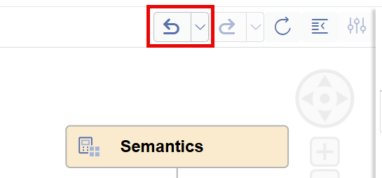

# Flexible Analytics at Speed: Calculation Views in SAP Business Data Cloud

Calculation Views are a well-established option for high-performance analytic reports. In this hands-on session while we will cover the basics of calculation view modeling in SAP Business Application Studio we at the same time widen the scope of calculation views. In particular, we will look at how AI functionality can be leveraged with Calculation Views and discover how calculation views integrate seamlessly into the SAP Business Data Cloud landscape.

## 1. Working with Calculation Views

You will create simple calculation views from scratch. With these calculation views you are building an analytics model for various products. You want to let users search products by natural language description and analyse matching sales orders for example in SAP Analytics Cloud.

In this section, next to general modeling techniques, you will learn how to prepare your development environment for calculation view modeling, work with vector embeddings, leverage materialization, use AI support for expressions and refactor calculation views.

## Some general tips when working with Calculation Views during the session

### Mistakes happen - that's life

-  If you did some mistakes in a calculation view editor, you can go back with the Undo button that you find at the top of your calculation view editor:

    

    If you close the editor the undo history will be cleaned up. 

### Solutions - if all goes wrong

- The resulting calculation views can be found in folder *solutions*. So you can have a look at them in case you are stuck and want to find out on your own where you are stuck. Or, you want to skip some exercises and continue based on the solution calculation views.
    
    > Of course we are happy to answer your questions any time as well.

### Emtpy space
When copying names, make sure to not add empty spaces before or after the name.

In the text, the goal of the next steps is described in italics prior to the description of the exact steps, often followed by a screenshot. In case you are already familiar with the topic you can also try to achieve the goal on your own and only look at the described steps in case you are stuck. 

Before we can actually start working with calculation views we have to first prepare the development environment.

[next exercise](./README1.1.md)
