### 1.1 Preparing the Development Environment

#### 1.1.1 Creating a Developer Space

A developer space is the environment in which you will develop objects and that you can customize to your needs. To start developing thus create a developer space first.

*Create a SAP HANA Native Application dev space DevSpace_\<your user name\> under <todo> and start it*

- Browser Chrome enter: <todo> to navigate to the dev space management
- Click on button **Create Dev Space** to create a Dev Space:

    

==> The dev space creation screen will open

- Enter the following information to specify the Dev Space:
    
    1. Use **DevSpace_\<your user name\>** as the name for the developer space. Replace \<your user name\> with your user name. Your username starts with *CFN_* and ends in the three digits that are stuck to your computer (1.).
    2. Choose **SAP HANA Native Application** as the type of application that you want to develop. This includes all necessary extensions to model calculation views (2.)
    3. Press **Create Dev Space** (3.)

    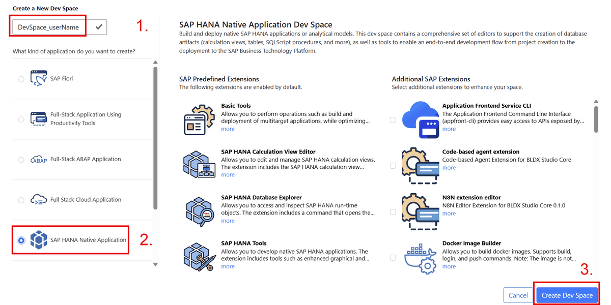

==> The dev space will be created

When the dev space has been created:

- Open the dev space by clicking on the name of the dev space:

    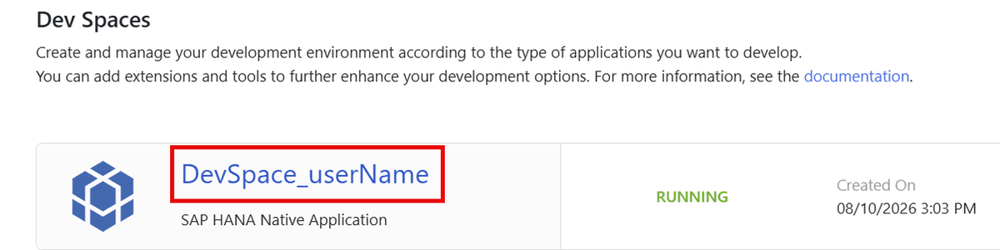

==> The dev space will be opened

#### 1.1.2 Creating a Project

Before you can model a calculation view you need to create a project in which you develop your calculation view later:

*Create a HANA Project P_\<your user name\>*:

- Agree to provide feedback by clicking OK:

    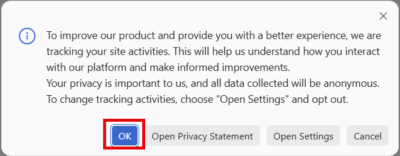

- In the hamburger menu (1.), choose File (2.) and New Project from Template (3.)

    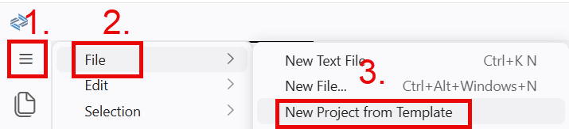

- Choose *SAP HANA Database Project* as template (1.) of your project and press *Start* (2.)	

    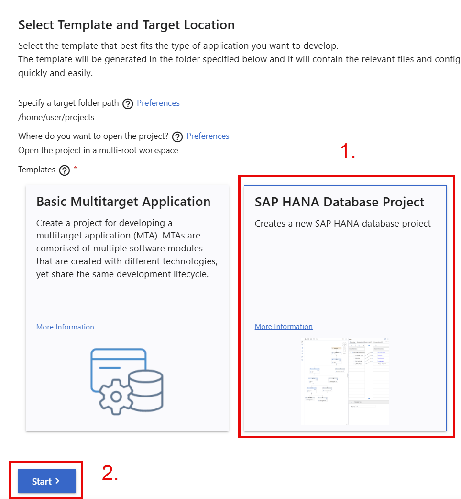

- Enter \<your user name\> as name of the project (1.) and choose *Next* (2.):

    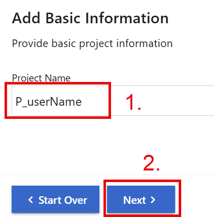

- Accept the default module name and press *Next*:

    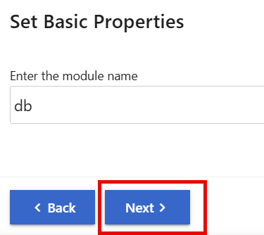

- Press *Next* to accept the database defaults:

    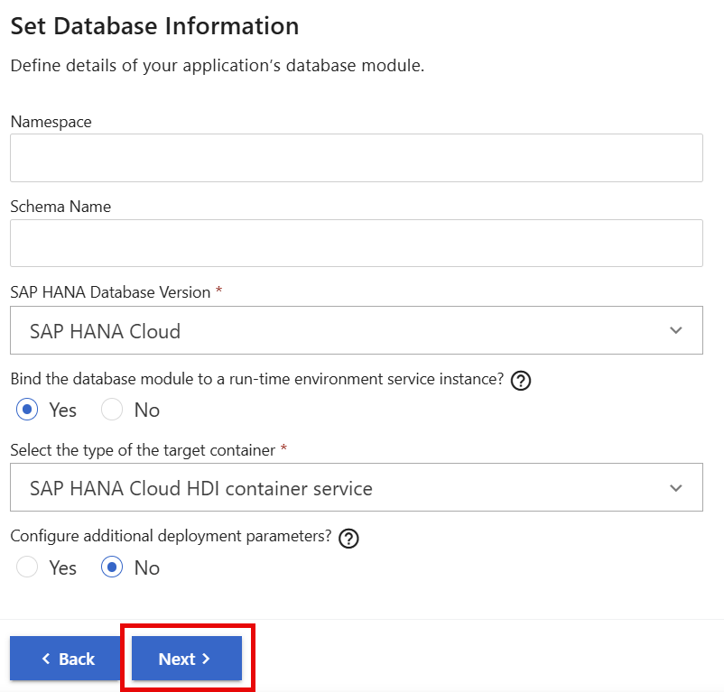

- When asked to sign-in into Cloud Foundry:****

    - Click on the URL:

        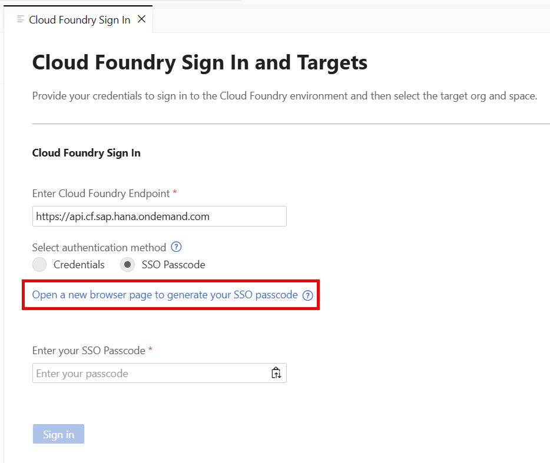
    
    - Copy the authentication code in the newly opened tab:

        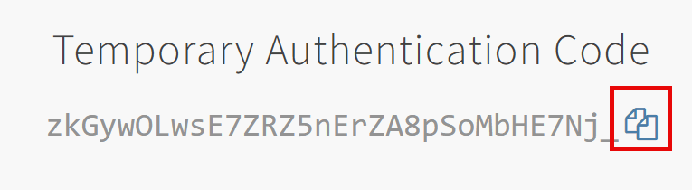

    - Go back to the project creation tab, paste the authentication code (1.) and choose *Sign in* (2.):

        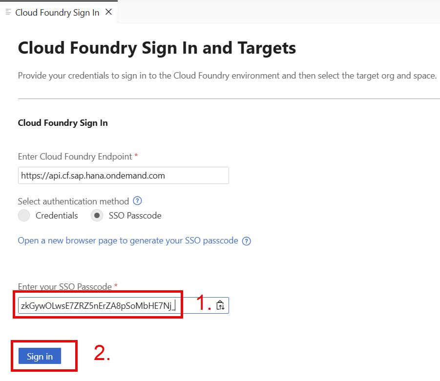

    - Click Apply to choose the selected Organization and Cloud Foundry Space: 

        todo

    - Keep the default and press *Finish*:

        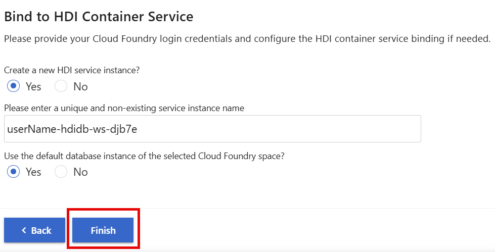

==> A Project with your name will be created and added to your Workspace:

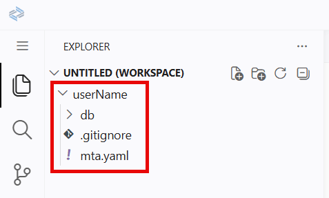

Wait until the project has been created and opened.

#### 1.1.3 [Managing Access](https://help.sap.com/docs/hana-cloud-database/sap-hana-cloud-sap-hana-database-modeling-guide-for-sap-business-application-studio/caded0fcf0eb4e9498bdff8f43d1a6a7.html)

By default a project has only access to its own objects. If objects from outside the project should be accessed then these privileges need to be granted. We will grant these privileges using an user provided service.

##### 1.1.3.1 Creating an User Provided Service

*Create an user provided service named UPS_\<your user name\> and add the service to your project*

- Expand the sections *SAP HANA Projects* and your project on the lower left (1.) and choose *add database connection* (2.):

    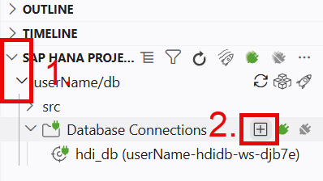

- Specify the database connection details:

    > Make sure to replace in the following *\<your user name\>* with your user name in **uppercase**

    - Choose *Create user-provided service instance* (1.)
    - Enter *UPS_\<your user name \>* as service instance name (2.)
    - Enter *UPS_\<your user name \>* also as the database user (3.) (todo: create users: create user UPS_yourUserName password "tIAUPEWN1!";
alter user UPS_yourUserName disable password lifetime;
grant select on schema TECHED2026_DA264 to UPS_yourUserName with GRANT OPTION;)

    - As password enter the password from the flipchart (4.)
    - Choose to generate the .hdbgrants file (5.)
    - Press "Add" to accept the specifications (6.)

    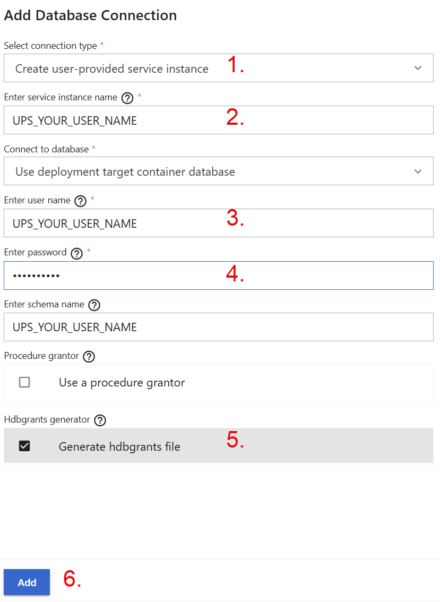

==> A user provided service has been created and added to your project. Also a .hdbgrants file has been generated

##### 1.1.3.2 Granting Privileges Using the User Provided Service

*Grant SELECT privileges on schema **TECHED2026_DA264** using the User Provided Service*

- In the Explorer window on the top-left, expand your project (1.) and click on the file *UPS_\<your user name\>.hdbgrants* (2.) to open it:

    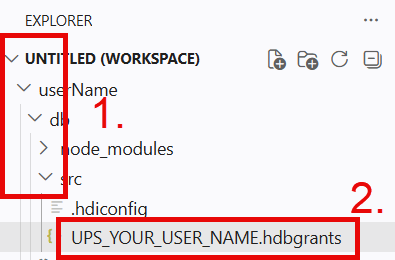

- In the opened .hdbgrants file:
    - Select tab *Object Owner* (1.)
    - Enter *TECHED2026_DA264* as schema (2.)  
    - Remove all privileges except for *SELECT* by clicking on the small trash icon behind each privilege that should be removed (3.) 

    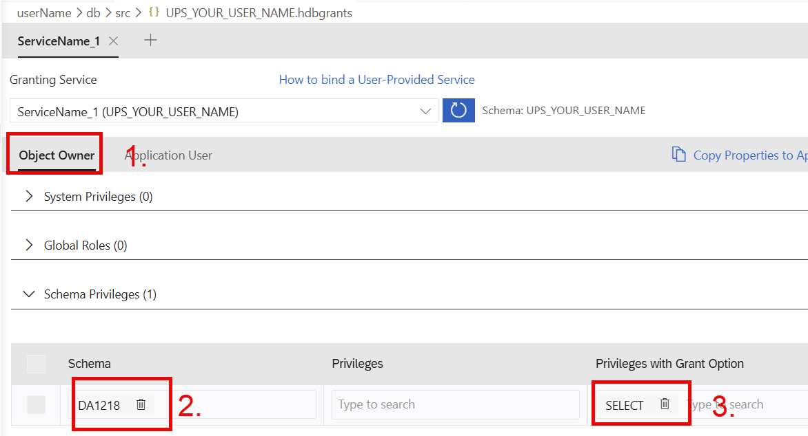

    ==> When deployed, this will grant SELECT WITH GRANT OPTION on schema *TECHED2026_DA264* to the object owner 

    - Select tab *Application User* (1.)
    - Enter *TECHED2026_DA264* as schema (2.)
    - Remove all privileges except for SELECT (3.)
    - Deploy the .hdbgrants file by pressing the rocket icon (4.)

    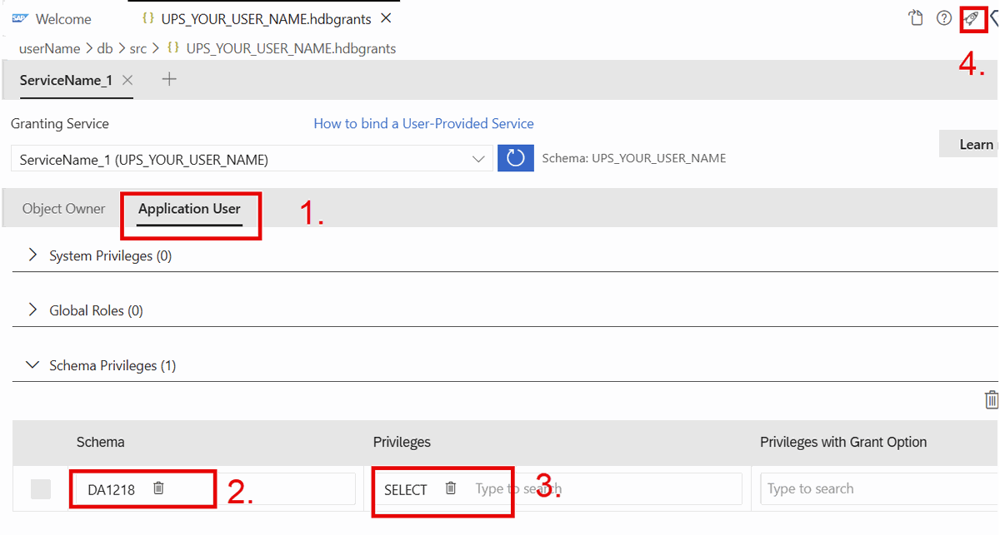

    ==> The defined privileges will now be granted to the object owner and the application user using the database user that you have specified when creating the user provided service. Afterwards your project can report on objects in schema *TECHED2026_DA264*

##### 1.1.3.3 Mass Generation of Synonyms

You've granted *SELECT* privileges for schema *TECHED2026_DA264* and thus are allowed to create models on top of tables in schema *TECHED2026_DA264*. However, HANA Deployment Infrastructure (HDI) requires that you refer with synonyms to objects outside of the current HDI container. Let's create these synonyms next.

*Create Synonyms for all Tables in Schema TECHED2026_DA264*

- On the top left, right-click on folder "src" (1.) and choose *New File* (2.):

    

- Enter the name *TECHED2026_DA264.hdbsynonym* , press *ENTER* and click on the file to open it

    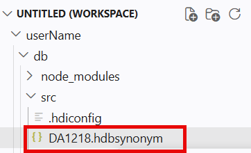

- In the opened synonym editor click on button *Mass Import of Synonyms*:

    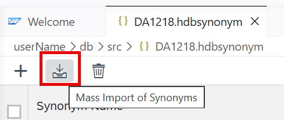

- In the dialog:

    - Choose your user provided service (1.)
    - Select schema *TECHED2026_DA264* (2.)
    - Confirm with OK (3.)

    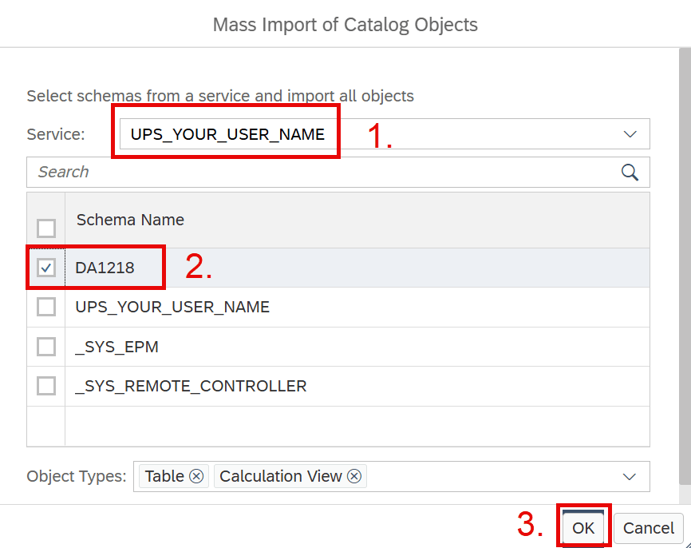

- You will see synonym proposals, deploy them by clicking the rocket icon:

    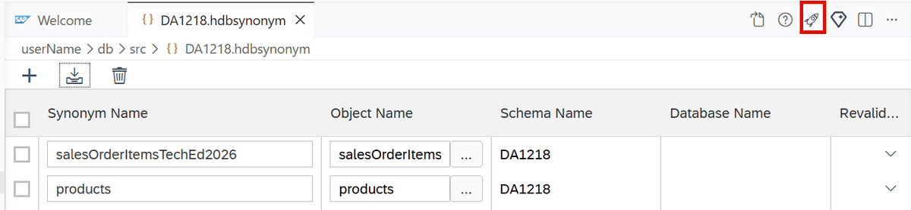

==> The synonyms to both tables in schema *TECHED2026_DA264* have been created and can now be used during modeling