### 1.2 Modeling Calculation Views

After we have granted the required privileges and created synonyms for objects that are not included in our project, we can now start creating calculation views.

#### 1.2.1 Creating a Calculation View

The first calculation view will later (indirectly) serve as a dimension view of a star join. Its purpose is to deliver product descriptions in natural language. To allow searching with natural language in the descriptions, we embed the descriptions.

*Create a calculation view "storeEmbeddingsProductDescription" of "Data Category" "Dimension" and consume the table "products".*

- Create Calculation View of type *Dimension*:

    - Right-click on folder *src* and choose *New File*:

        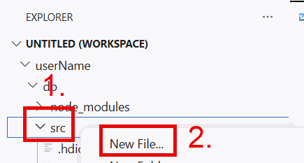

    - Enter *storeEmbeddingsProductDescription.hdbcalculationview* as filename and press *ENTER* to accept the name:

        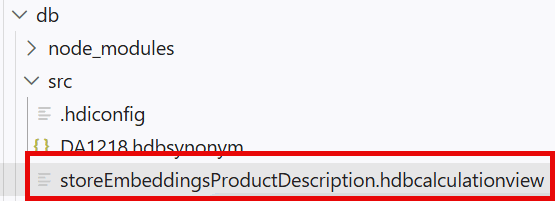

    - Select "Dimension" (1.) and press "Create" (2.):

        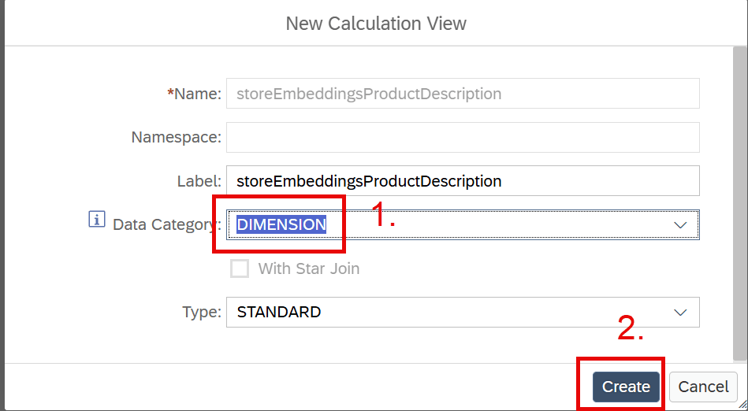

==> The calculation view *storeEmbeddingsProductDescription* is created as a Dimension View.

- Add table *products* as data source to node *Projection*:

    - Click on *Add Data Source* icon:

    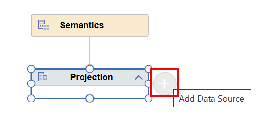

    - Search for table *products*:

        - Enter *products* in the search field (1.)
        - Select the table *products* (2.)
        - Choose *Finish* (3.)

        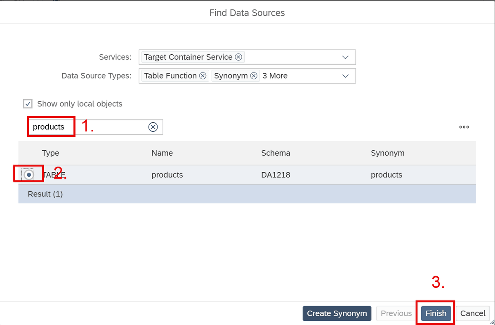

==> The table *products* is added as a data source and can be used in the model

- Add all columns to the output:

    - Double-click on node *Projection* to open the details view on the right (1.)
    - Click on tab *Mapping* to show the column mappings (2.)
    - In the details click on the table source of the Projection to select it (3.)
    - Use the *Add to Output* button to map all columns to the output (4.) [alternatively: Double-click on the table source]

    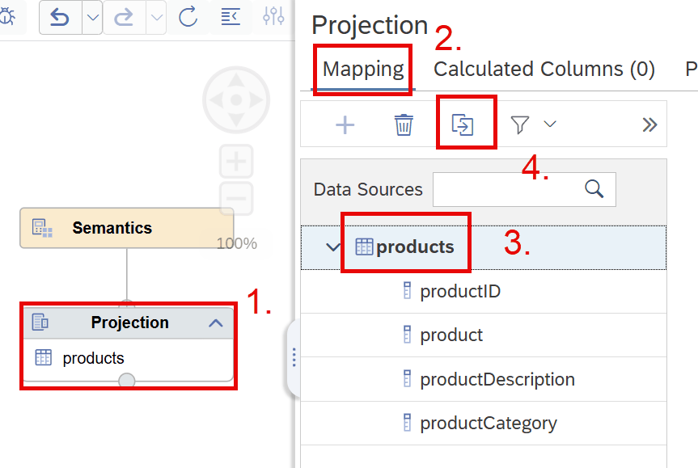

 *Embed the text of column "productDescription" in column "embeddedProductDescription"*

- Add a calculated column:

    - Select tab *Calculated Columns* (1.)
    - Use the *Add* button (+ sign) to create a new calculated column (2.)
    - Click on the created calculated column to open the details (3.)

    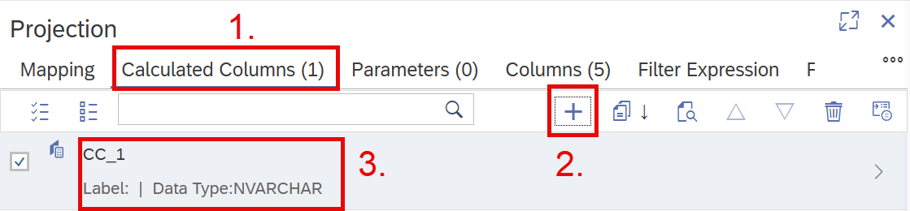

- Enter the details for the calculated column:

    - Enter *embeddedProductDescription* as the name of the calculated column (1.)
    - Choose *Real_Vector* as datatype (2.)
    - Expand the SQL expression section (3.)
    - Click on *Expression Editor* to open the editor (4.)

    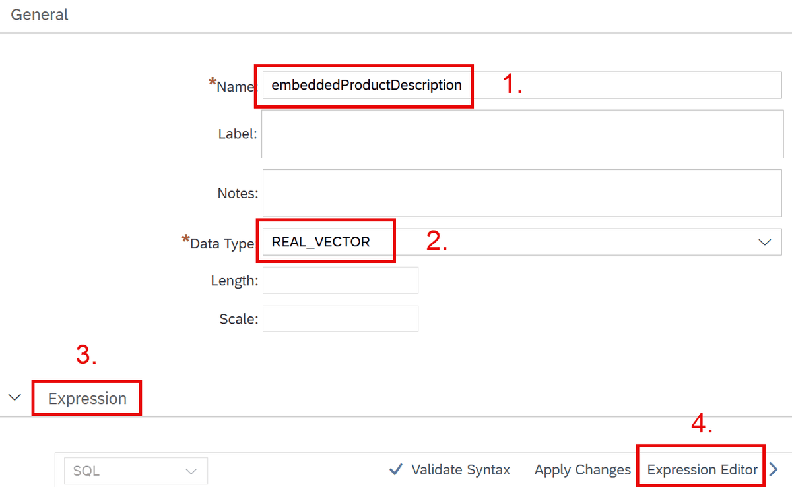


- Define the expression of the calculated column:

    You can enter the expression either with or without support by AI. Choose which option you prefer but ensure that the resulting expression is VECTOR_EMBEDDING("productDescription", 'DOCUMENT', 'SAP_GXY.20250407')

    - With AI-support:
        - Enter the comment *-- create a document vector embedding for column productDescription with model SAP_GXY.20250407* (1.)
        - Click on the drop-down of the *AI action* button (2.)
        - Select *Generate Expression with AI* (3.)

        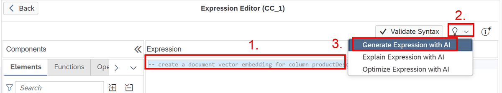

        ==> The generated expression should look like *VECTOR_EMBEDDING("productDescription", 'DOCUMENT', 'SAP_GXY.20250407')* 
    
        If it looks differently, adjust it manually

    - Without AI-support:
        - On the left side click on tab *Functions* to display the available functions (1.)
        - Search for functions that include the term *vector* (2.)
        - Click on function *VECTOR_EMBEDDING* to add the function to the right (3.)

        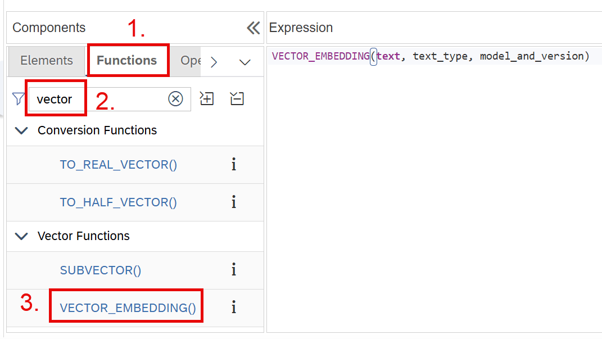

        - To fill in for the placeholders:
            - Choose tab *Elements* to display the columns (1.)
            - Expand the *Columns* to see all columns (2.)
            - Double-click on "text" on the right side to select it (3.)
            - Click on column *productDescription* to replace the marked text on the right side with the column name (4.)

        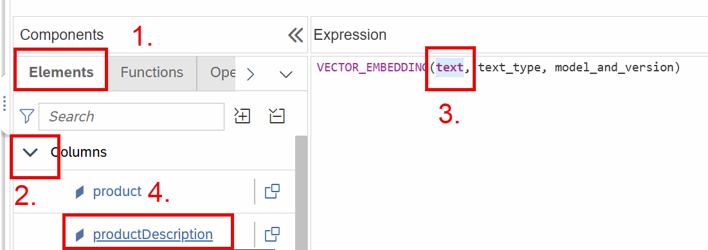
    
        ==> The expression should now look like *VECTOR_EMBEDDING("productDescription", text_type, model_and_version)*

        - Replace *text_type* with *'DOCUMENT'* 
        - Replace *model_and_version* with *'SAP_GXY.20250407'*
        - Make sure the expression looks exactly like: *VECTOR_EMBEDDING("productDescription", 'DOCUMENT', 'SAP_GXY.20250407')*

        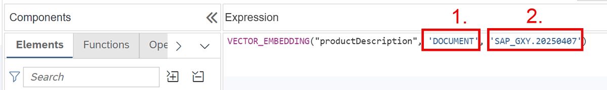

        - Click on *Back* to move back to the details of the calculated column and *Back* again to get back to the calculated column overview

        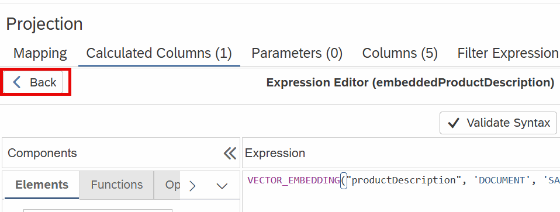


*Add input parameter *QueryString* that will be used to enter the search string*

- Add an input parameter:

    - Click on tab *Parameters* (1.)
    - Use the *Add* drop-down (2.) to select *Input Parameter* (3.)

    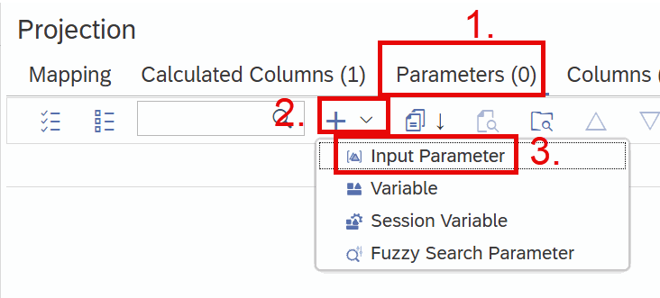

    - Click on the created input parameter to open the details of the input parameter

    - Name the input parameter *QueryString* (1.)

    - Expand the respective sections and
    
        - Assign the data type *NVARCHAR* with length *200* (2.)
        - Enter *water proven* as *Default Value* (3.)
        - Press *Back* to close the input parameter editor screen (4.)
    
    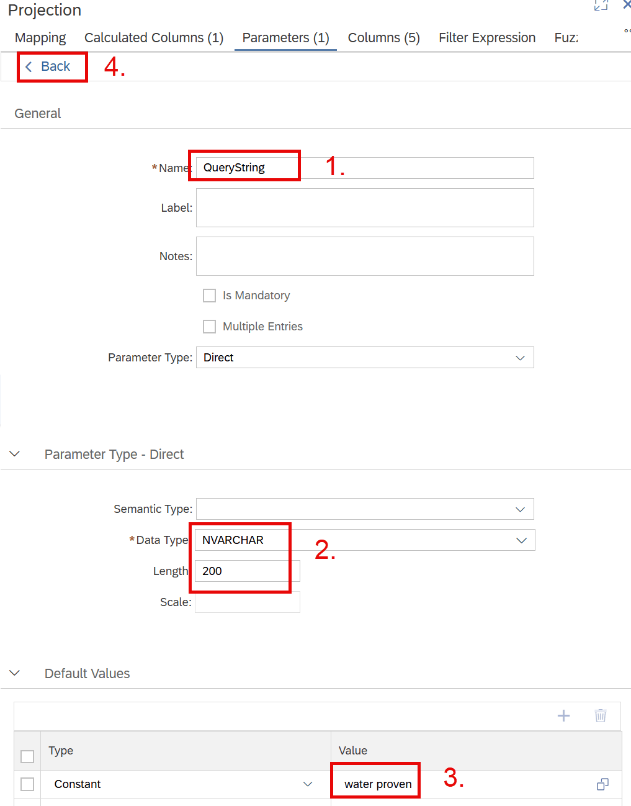

*Add a calculated column "SimilarityQueryProductCategory" that calculates the similarity between the entered string and the product description*

- Add a calculated column:

    - Choose tab *Calculated Columns*
    - Add a new calculated column with the *+* icon
    - Click on the newly created calculated column to enter its details
    - Name the calculated column *SimilarityQueryProductCategory* (1.)
    - Use *Double* as *Data Type* (2.)
    - Open the Expression Editor by expanding the section and clicking on *Expression Editor* (3.)

    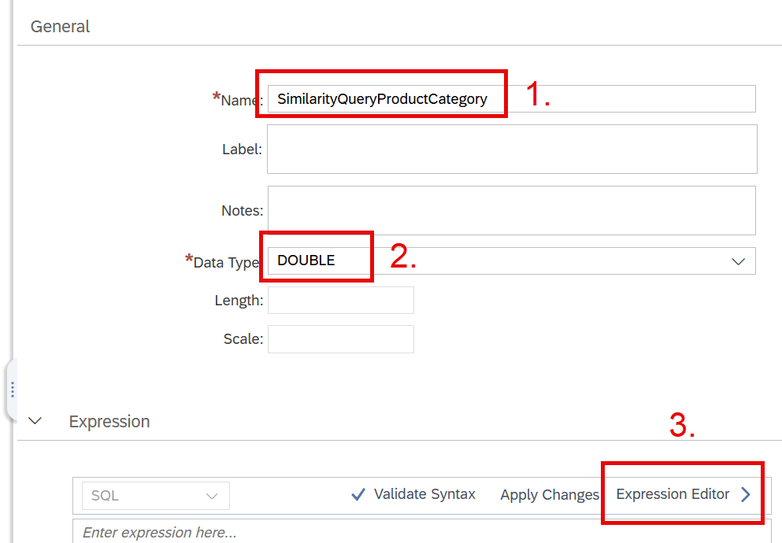

- Define the expression for the calculated column:

    - To define the expression using AI support:
    
        - Enter the comment:

            ```SQL
            -- calculate the similarity between the input parameter value and product description
            ```
         todo: is query and model required?
    
        - Use the AI drop-down to select *Generate Expression with AI*

            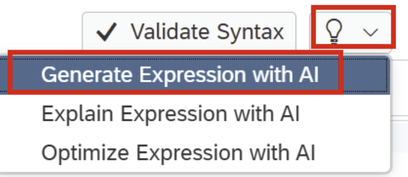

            A dialog will inform you that the expression could not be validated (This is because the SQL validation currently rejects vector types). 
        
        - Choose button *Insert Anyway* to add the generated expression into the expression editor

        - Check that the expression reads: 
        
        ```SQL
        COSINE_SIMILARITY(VECTOR_EMBEDDING('$$QueryString$$', 'QUERY', 'SAP_GXY.20250407'),"embeddedProductDescription")
        ```
        
        If not, adapt it.

    - To define the expression without AI support:

        - Search for functions with *similarity* in their name:

            - Choose tab *Functions* (1.)
            - Enter *similarity* as the search string (2.)
        
        - Add *COSINE_SIMILARITY()* to the expression:

            - Click on *COSINE_SIMILARITY()* to add the function to the expression (3.)

        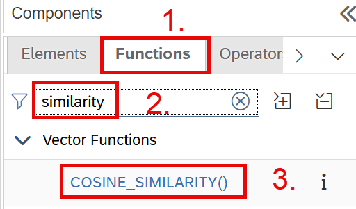
        
        - Replace placeholders:

            - Search for *embedding* functions (1.) 
            - Double-click on the right in the expression editor at *vector1* to highlight it  (2.) 
            - Click on *VECTOR_EMBEDDING()* to replace the highlighted *vector1* with the function (3.)

            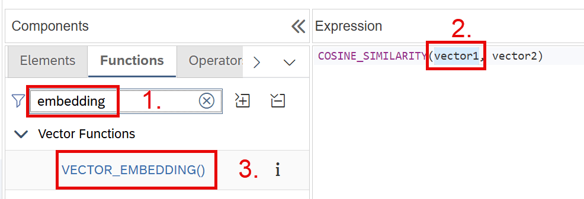
            
            - Move to tab "Elements" (1.)
            - Mark *vector2* and replace it with calculated column *embeddedProductDescription* by clicking on it (2.)
            - Replace "text" with input parameter *QueryString* (3.)

            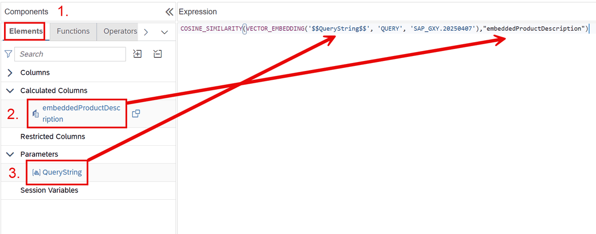

            - The expression should now read: 
            
                ```SQL
                COSINE_SIMILARITY(VECTOR_EMBEDDING('$$QueryString$$', 'QUERY', 'SAP_GXY.20250407'),"embeddedProductDescription")
                ```
                
                
- Deploy the calculation view with the rocket icon. Alternatively deploy it by pressing *CTRL* and *d*

    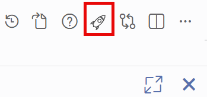

==> You have created and successfully deployed a dimension calculation view


*Run a data preview as a quick check*

- Right-click on node *Projection* (1.) and choose *Graphical SQL Data Preview* (2.)

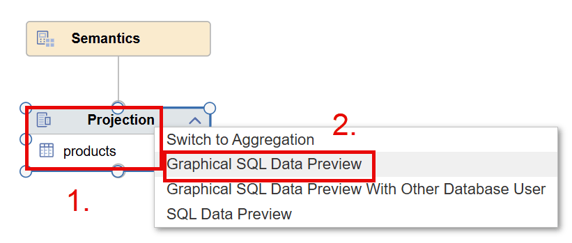

You will be prompted for a value of your input parameter *QueryString*:
    
- Either keep the default value *water proven* or change it to a product description that you are interested in (1.)
- Press the "start" button *Open Content* to display the values (2.)

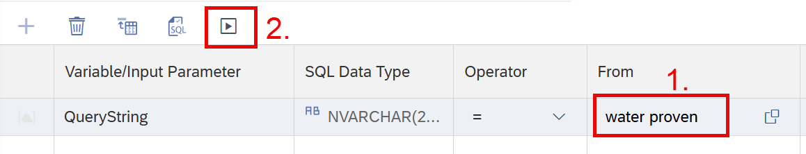

==> You see data that includes a similarity score in the last column

#### 1.2.2 Materialization

As you experienced when running the data preview, calculating the embeddings for the individual product descriptions took quite some time. The embeddings are rather stable so it is beneficial to calculate them once and store them. We will use the calculation view snapshot option to achieve this.

##### 1.2.2.1 [Defining a Calculation View Snapshot](https://help.sap.com/docs/hana-cloud-database/sap-hana-cloud-sap-hana-database-modeling-guide-for-sap-business-application-studio/d35f768ce50145d2ad0e5916898f004d.html)

*Create in calculation view "storeEmbeddingsProductDescription" snapshot query "AllColumns" that uses the default query*

- Click on (or reopen) the tab with calculation view *storeEmbeddingsProductDescription*
- Double-click on node *Semantics* to open the semantic details (1.)
- Choose tab *View Properties* (2.) 
- Select *Snapshots* (3.)

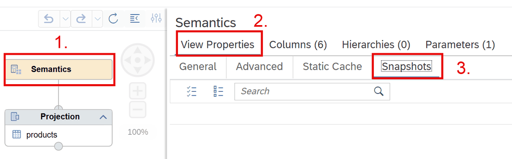

- Add a Snapshot:
    - Click on the *+* sign to add a snapshot (1.)
    - Click on the generated snapshot query to open the details (2.)

    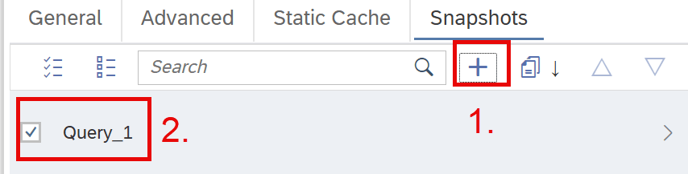

    - Define the snapshot details and deploy:

        - We keep the default query that you see at the bottom which includes all columns. Thus name the snapshot query *AllColumns* (1.)
        - Press the Deploy rocket on the top (alternatively CTRL+d) to deploy the calculation view with the snapshot definition. Successful deployment of the snapshot definition is required for the next step (2.)

            The deployment will take quite some time because you've kept option *Create Snapshot After Deployment Automatically* which will calculate the embeddings and store them in the snapshot when deploying. Wait till deployment finishes.

*Generate a default interface view*

- Click on the rocket next to the interface view name once (3.) This will generate an interface view that offers the choice to direct a query, based on an input parameter value, either to the snapshot or the actual calculation view.

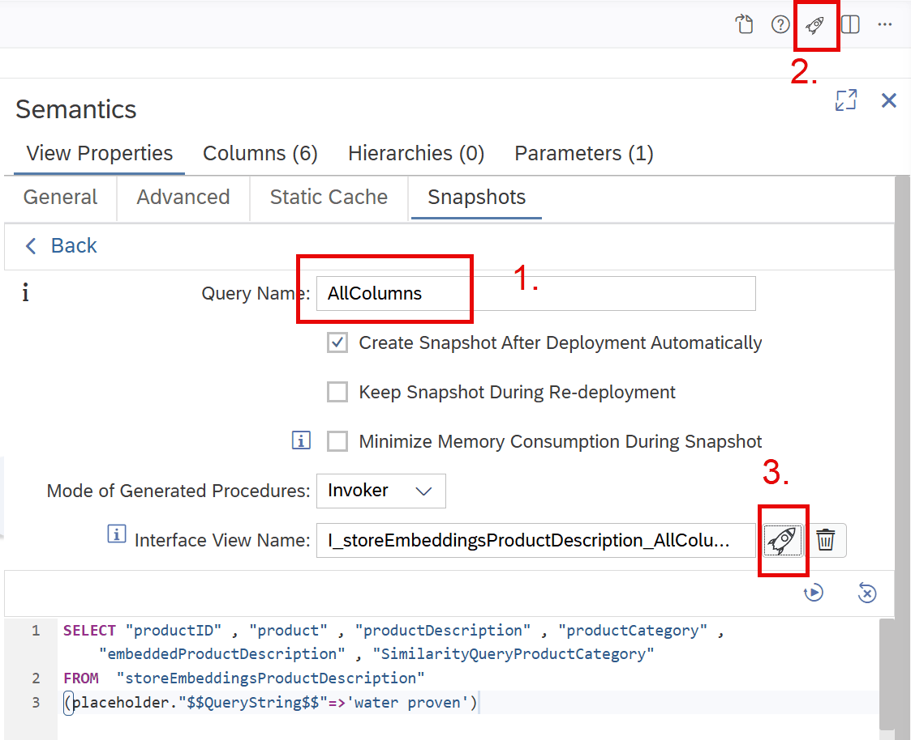

==> On the left side in the file tree you can see that a new file *I_storeEmbeddingsProductDescription_AllColumns* has been created. The new calculation view is automatically deployed. 

The generated calculation view makes use of [union pruning](https://help.sap.com/docs/hana-cloud-database/sap-hana-cloud-sap-hana-database-performance-guide-for-developers/pruning-based-on-constant-mapping-e0db50b5a333491783bc9999b1354120) to decide based on an input parameter whether a query should be directed to the snapshot table or the calculation view. If you are curious about how this works, let's have a quick look at it. You can otherwise move to *Test the different input parameter values...*:

- Double-click on calculation view *I_storeEmbeddingsProductDescription_AllColumns* on the left to open it
- Double-click on the node *Union_1* to show the details (1.)
- Click once on tab *Mapping* (2.)
- Right-click on column SOURCE and Choose *Manage Mappings* (3.)

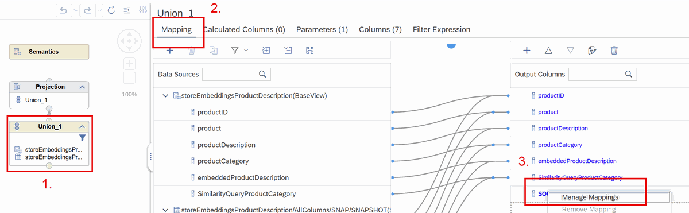
    
==> The mapping for union pruning is shown. 

    The following constants are defined:
        
    - BASE is assigned to the calculation view source
    - SNAPSHOT is assigned to the snapshot table source 

- Press button *Cancel* to close the dialog

The selection between the sources is implemented in the filter expression that compares the input parameter *I_SOURCE* to these constants. To see this, click on tab *Filter Expression*:
        
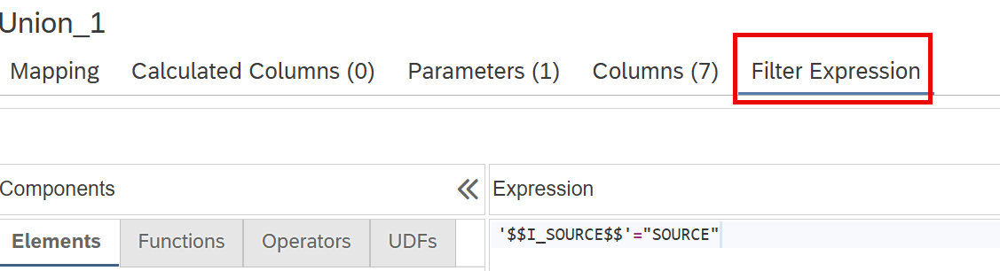


*Test the different input parameter values "BASE" and "SNAPSHOT" in a data preview to see the performance impact*

Start a data preview to see the impact of the snapshot table:
    
- Right-click on node *Projection* (1.)
- Choose *SQL Data Preview* (2.)

    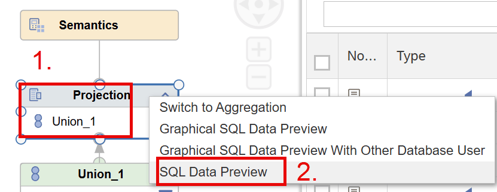

    ==> A new tab will open that shows the default query

    As you can see from there, the input parameter is filled with the default value *SNAPSHOT* (1.), the query is thus directed to the snapshot.

    - Run the query by pressing the green triangle on the top left:

    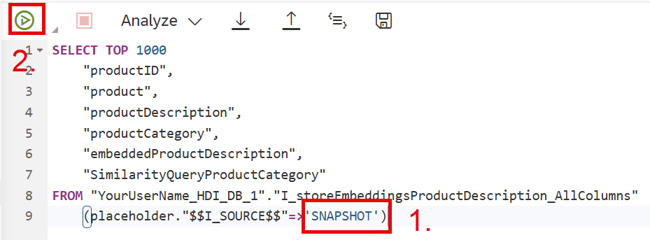

    - Compare the runtime to the time it takes when you switch back to the calculation view that calculates the embeddings on the fly:
        - In the SQL query: Replace *SNAPSHOT* with *BASE* (1.)
        - Run the query by pressing the green triangle on the top left (2.)

        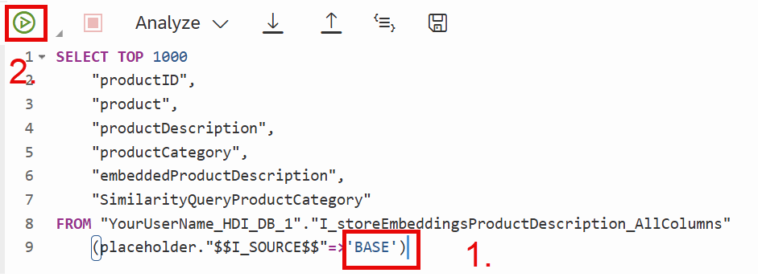

==> Whether a query is directed to the snapshot table or the calculation view makes a huge difference in query runtime. By leveraging input parameter *I_SOURCE* end users can easily choose whether data as of the last time the snapshot table was updated is acceptable or the data need to be current. The update of the snapshots can be scheduled using e.g. [hdbschedulerjobs](https://help.sap.com/docs/hana-cloud-database/sap-hana-cloud-sap-hana-database-performance-guide-for-developers/f92e31d2a23f4470829ab300dcce850e.html?locale=en-US&state=PRODUCTION&version=2026_2_QRC).

##### 1.2.2.2 [Creating an MDS Cube](https://help.sap.com/docs/hana-cloud-database/sap-hana-cloud-sap-hana-database-modeling-guide-for-sap-business-application-studio/0e5f70d8c7204cc69839aa9452717753.html)
MDS Cubes are a complementary option to materialize data. Their data structure is optimized for analytic reporting in SAP Analytics Cloud. Currently, no SQL access is available.

We will create an MDS Cube later on the topmost calculation view to which reporting will be directed.