### 1.3 Refactoring Calculation Views

We will use several calculation view modeling features to adjust the created calculation views. For example, we will move calculated columns and propagate input parameters to adapt to newly created calculation views. In a hypothetical scenario we will assume that you started to use the simple dimension view in a star join and then realized that the interface view is the better choice. We will cover the steps how you could adjust your star join to use the interface view instead.

#### 1.3.1 Move a Calculated Column 

*Move the calculated column "SimilarityQueryProductCategory" from calculation view "storeEmbeddingsProductDescription" to the union node of calculation view "I_storeEmbeddingsProductDescription_AllColumns"*

The interface view combines two sources. Logically it makes more sense to place the similarity calculation into the interface view so that it works on both sources instead of keeping it only in source *storeEmbeddingsProductDescription*. Let's move the calculation to the Union node:

- Copy and remove calculated column *SimilarityQueryProductCategory*:
    - Click on (or reopen) the tab with calculation view *storeEmbeddingsProductDescription*
    - Double-click on node *Projection* to open the details (1.)
    - Click on tab *Calculated Columns* (2.)
    - Make sure that only calculated column *SimilarityQueryProductCategory* is selected (3.)
    - Open the drop-down of the Copy icon (4.)
    - Choose *Copy* to copy the selected calculated column (5.) 
    - If a pop up appears and asks whether it is allowed to share clipboard information, choose *Allow*

        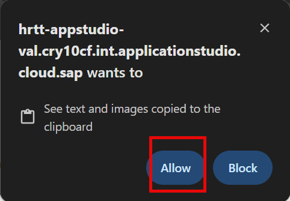

    - Click on the trash icon to delete the calculated column (6.) 

        You will be informed about the consequence that the calculated column will disappear from the output of node *Projection*
    - Choose *Yes* to accept it.

    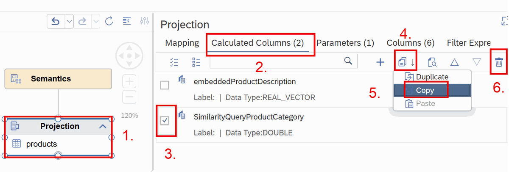

- Insert the calculated column into the Union node of calculation view *I_storeEmbeddingsProductDescription_AllColumns*:
    - Click on (or reopen) the tab with calculation view *I_storeEmbeddingsProductDescription_AllColumns*

        The Union node has the column *SimilarityQueryProductCategory* already mapped from the source. If we simply copied the calculated column we would end up with two columns that do the similarity calculation. Let's remove the mapping first (we could alternatively have [propagated the deletion](https://hana-app-studio-ea.cry10cf.int.applicationstudio.cloud.sap/index.html) from the source view similar to what we will do with the propagation of the input parameter later):
    - Remove mapping of column *SimilarityQueryProductCategory*:
        - Double-click on node *Union_1* to open the details
        - Click on tab *Mapping* to display the column mappings (1.)
        - On the *Output Columns* side on the right: right-click on column *SimilarityQueryProductCategory* (3.)
        - Choose *Remove Output Column*
        - In the dialog, accept that the dependencies will also be removed by selecting *Yes*
    
    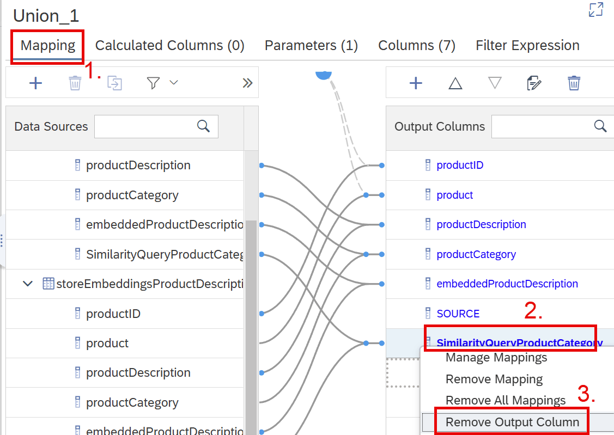

    ==> The mapping of column *SimilarityQueryProductCategory* has been removed. 
    
    Let's add it as calculated column (we still have the definition in the clipboard)

    - Insert the copied calculated column:

        - Select tab *Calculated Columns* to work on calculated columns (1.)
        - Use the drop-down of the Copy icon (2.)
        - Choose *Paste* (3.)
        - A dialog appears with the warning that the calculated column relies on an input parameter that is not available in the target view. Insert the calculated column with *Continue* - we will take care about the missing input parameter later.

    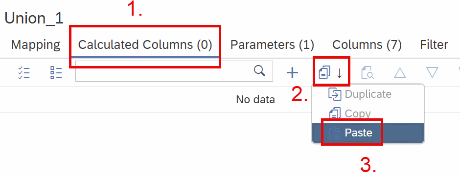

==> The calculated column has been moved from one calculation view into another. 

To include the calculated column *SimilarityQueryProductCategory* in the result, it needs to be available as an output column. Let's add it:

- Add calculated column *SimilarityQueryProductCategory* to the output:
    - Double-click on node *Projection* to open the details
    - Click on tab *Mapping* to see the defined mappings (1.)
    - The new calculated column *SimilarityQueryProductCategory* has not been added to the output yet. Double-click on it on the left side, so that it is added on the right side. (2.)

    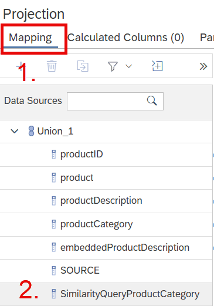

==> *SimilarityQueryProductCategory* is available as output column of calculation view *I_storeEmbeddingsProductDescription_AllColumns* for reporting

By removing calculated column *SimilarityQueryProductCategory* from view *storeEmbeddingsProductDescription* the current snapshot query is referring to a non-existent column. Let's correct this:

- Correct snapshot query:

    - Click on (or reopen) the tab with calculation view *storeEmbeddingsProductDescription*
    - Double-click on node *Semantics* to open the details
    - Choose section *View Properties*
    - Click on tab *Snapshots* (1.)
    - If the details of snapshot query *AllColumns* are not displayed, click on the snapshot query to open the details
    - Click on button *Reset Query* to adapt the snapshot query to the currently available columns (2.)

    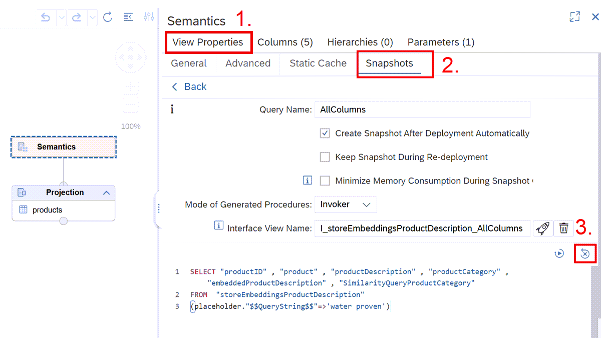

==>  To ensure that the database representation is updated, deploy all calculation views:

- In the SAP HANA PROJECTS explorer on the lower left (you might have to expand it first), press the rocket icon which is on the right of folder *src*. This will deploy all changed files in the project:

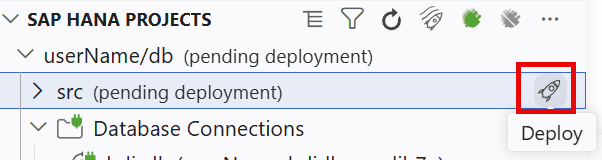

#### 1.3.2 Replace a Data Source

To illustrate another refactoring option, let's assume that you have started using your view *storeEmbeddingsProductDescription* in a star join and want to replace it with the interface view. In practice you might not have had the interface view available when you first built the star join. We're now simulating that situation to show how to replace a data source without rebuilding the view from scratch

Let's create the star join first.

##### 1.3.2.1 Creating a Star Join

*Create a star join calculation view "s_products" that uses table "salesOrderItemsTechEd2026" as fact source and "storeEmbeddingsProductDescription" as dimension view*

- Create a star join calculation view:
    - In the Projects Explorer on the left, right-click on folder *src* and choose *New File*
    - Name the new file *s_products.hdbcalculationview* and press *ENTER*

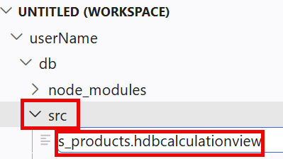

In the dialog: 
- Select option *With Star Join* (1.)
- Press button *Create* (2.)

    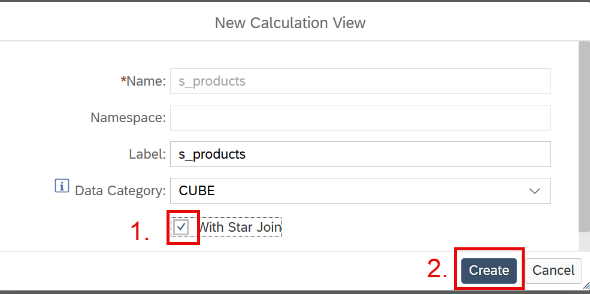

- Add table *salesOrderItemsTechEd2026* as fact data source:

    - Click on the Projection icon on the left (1.)
    - Move the mouse below the star join node and click there (2.)

    ==> The Projection node will be placed below the star join node

    - Click on the + sign to add a data source (3.)

    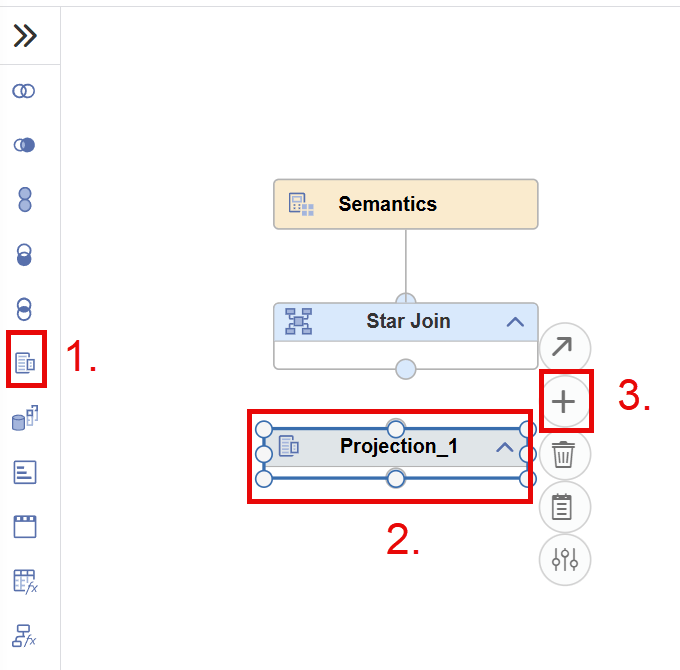

    - Enter the search term *salesOrder* (1.)
    - Select Table *salesOrderItemsTechEd2026* (2.)
    - Press button *Finish* (3.)

    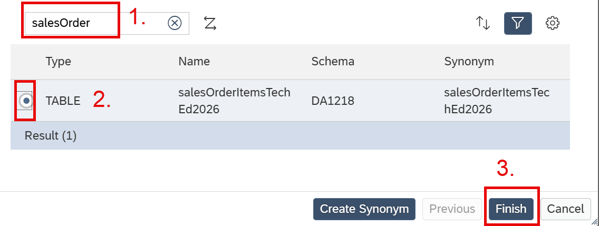

- Connect the output of node *Projection_1* as input to node *Star Join*:

    - Click on the arrow, while holding the mouse button down, move the mouse to the small circle at the bottom of the Star Join node and release the mouse button

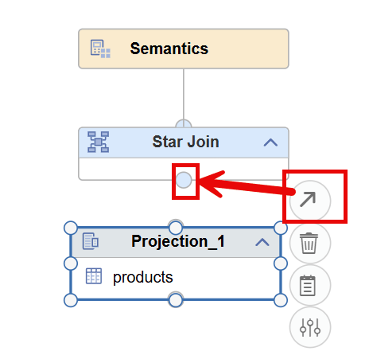

==> An arrow should now connect node *Projection_1* to node *Star Join*:

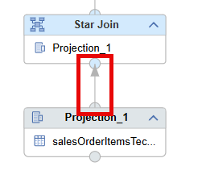

- Choose which columns should be mapped to the output of node *Projection_1*:

    - Double-click on node *Projection_1* to open the details
    - Click on tab *Mapping* (1.)
    - Highlight data source *salesOrderItemsTechEd2026* by clicking once on it (2.)
    - Add all columns of the data source to the output by clicking on the *Add to Output* icon (3.)

    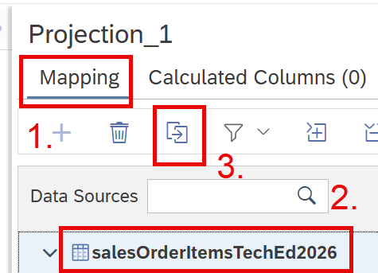

- Choose which columns should be mapped to the output of node *Star Join*:

    - Double-click on node *Star Join* to open the details
    - Click on tab *Mapping* (1.)
    - Highlight data source *Projection_1* by clicking once on it (2.)
    - Add all columns of the data source to the output by clicking on the *Add to Output* icon (3.)

    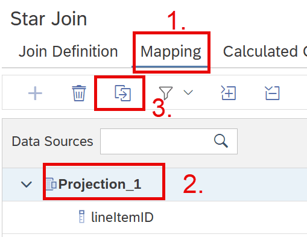

- Add a dimension view:

    - Click on the Star Join node so the + icon becomes available
    - Press on the + icon to start the selection of a dimension view

    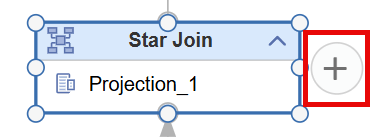

    In the dialog:

    - Enter the search term *storeemb* (1.)
    - Select the calculation view *storeEmbeddingsProductDescription* (2.)
    - Press Finish (3.)

    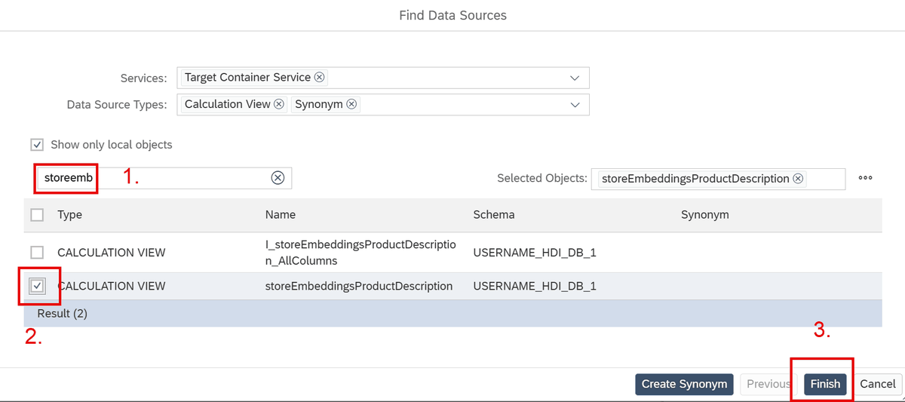

The columns of the dimension views in star join nodes are automatically projected to the output. Given that node *Projection_1* projects columns *product* and *productID*, the output columns would not be unique if the two columns were also projected from dimension view *storeEmbeddingsProductDescription* without modification. This is why you see a naming conflict resolution dialog. Let's make the column names unique by adding the prefix *PD* for ***P****roduct****D****escription*:

- Select option *Prefix* (1.)
- Choose *Free Text* (2.)
- Enter *PD* as the prefix (3.)
- Choose *OK* (4.)

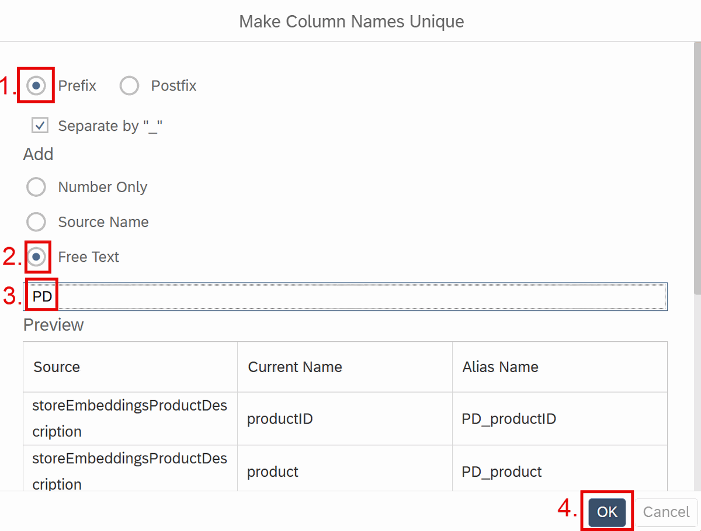

==> the prefix *PD* is added to all columns from the dimension view

- Define the join properties:

    - Double-click on node *Star Join* to open the details
    - Click on tab *Join Definition*
    - Click on column *productID* of source *Projection_1* (1.)
    - Hold the mouse button while moving over to column *productID* of source *storeEmbeddingsProductDescription* (2.) and release the mouse button
        
        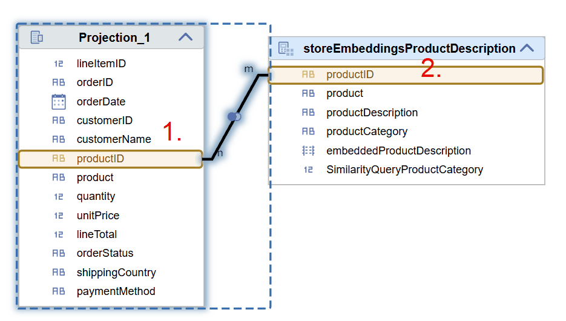
    
        A dialog informs you that column "productID" will be removed from the output. This is because by default the join output column will be retrieved from the dimension and the join column of the fact source is removed. If you wanted in addition an output join column from *Projection_1*, you would need to remap *productID* again explicitly under tab *Mapping*. 
    
    - Accept the behavior by clicking on *Yes* 

    ==> You see a line connecting both *productID* columns that defines a join condition

    Given that each value in column *productID* of *storeEmbeddingsProductDescription* appears only once while a value can appear multiple times in the transactional table of *Projection_1* set the Cardinality value to *n..1*:
    
    - Define the Cardinality:
    
        - If the Properties are not displayed, click on the connecting line until you see the Cardinality property:

        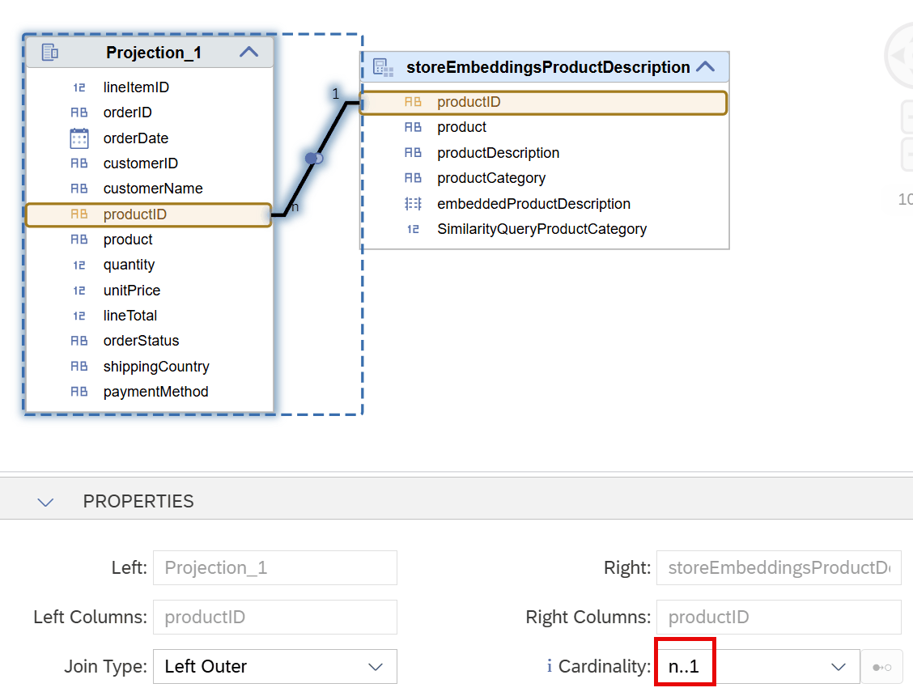

        - Set the cardinality to *n..1*

Let's assume you have created the star join with the original *storeEmbeddingsProductDescription* like you just did and only afterwards developed the interface view. Now that the interface view is available you want to use the interface view instead:

*In star join view "s_products" replace dimension view "storeEmbeddingsProductDescription" by "I_storeEmbeddingsProductDescription_AllColumns"*

- Replace *storeEmbeddingsProductDescription* by *I_storeEmbeddingsProductDescription_AllColumns*:
    - In the Star Join node: 
        - Right-click on the source *storeEmbeddingsProductDescription* (1.)
        - Choose *Replace With Data Source* (2.)

        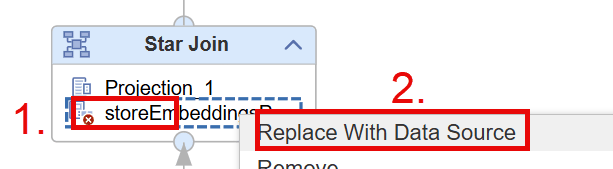
    
    - In the dialog:
        - Search for the interface view *I_storeEmbeddingsProductDescription_AllColumns* (1.)
        - Select the view (2.)
        - Press *Next* (3.)

        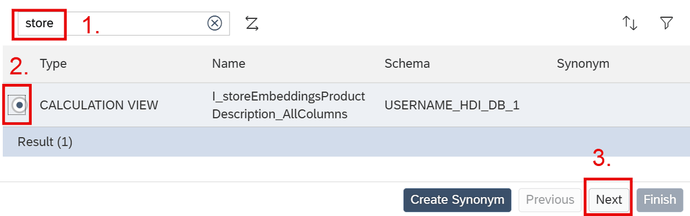

    - In the next dialog, you see what join mappings are proposed based on the column names. Keep the suggestion and press *Finish*

        Given that columns with the same name are available from source *Projection_1* and the dimension view, the naming conflict resolution dialog is started again. 

    - In the make unique dialog:

        - Choose *Prefix* (1.)
        - Choose *Free Text* (2.)
        - Enter *I_PD* (**I**nterface **P**roduct **D**escription) (3.)
        - Press *OK* (4.)

        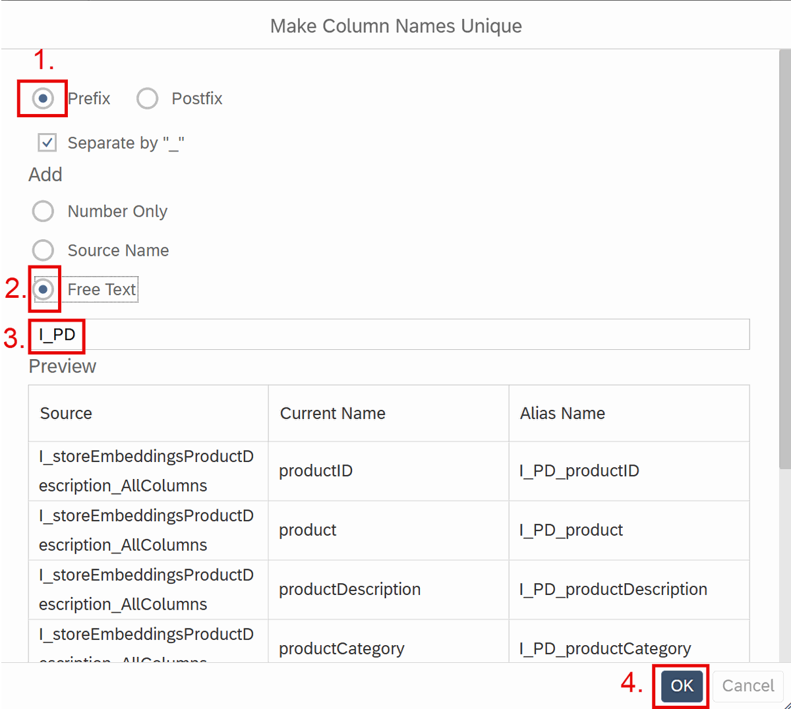

==> You have now successfully replaced one view with another while keeping the join information

You might wonder why the dimension source shows a red icon in the Star Join node. If you hover over the icon you will see an info box explaining that columns of e.g. type *REAL VECTOR* are not allowed in Star Join nodes (or any type of aggregation nodes). The reason is that *GROUP BY* on these data types is not supported by SQL.

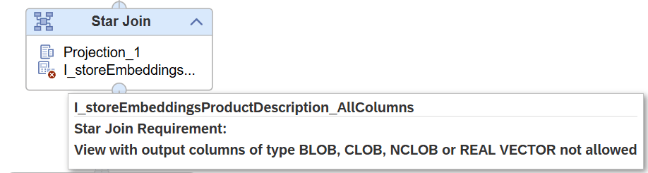

The culprit in this case is column *embeddedProductDescription*, which is of type *REAL_VECTOR*.

After the similarity has been calculated, we don't need the embedding of the descriptions anymore so let's quickly solve this issue by removing the embedding from the output of the dimension view. We could either remove the output column after the union node at which the similarity calculation is done, or hide it from the output of the interface view. For illustrative purposes let's do both. Both approaches solve the issue. We're doing both here purely to compare the two options:

*Remove column "embeddedProductDescription" from the output of view "I_storeEmbeddingsProductDescription_AllColumns"*

##### 1.3.2.2a Hide column *embeddedProductDescription* from the output of view *I_storeEmbeddingsProductDescription_AllColumns*
    
- Click on (or reopen) the tab with interface view *I_storeEmbeddingsProductDescription_AllColumns*
- Double-click on node *Semantics* to see the details
- Select section *Columns*
- Set the flag in column *Hidden* for the column with name *embeddedProductDescription* (1.)
- If the column *Hidden* is not shown, use button *Customize Column Display* (0.) to select it as a visible column

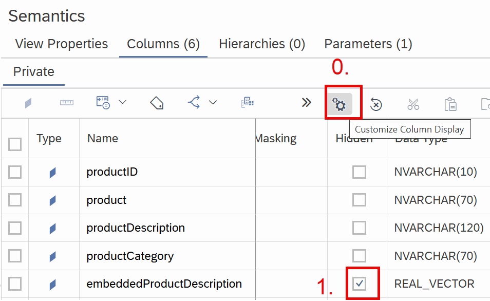

    
##### 1.3.2.2b Remove column *embeddedProductDescription* from the output of node *Projection*

- Click on (or reopen) the tab with interface view *I_storeEmbeddingsProductDescription_AllColumns*
- Double-click on node *Projection* to see the details
- Click on tab *Mapping* (1.)
- On the output side: right-click on column *embeddedProductDescription* (2.) and choose *Remove Output Column* (3.)
- You will be informed about the impact that this action has. Accept it with *Yes*

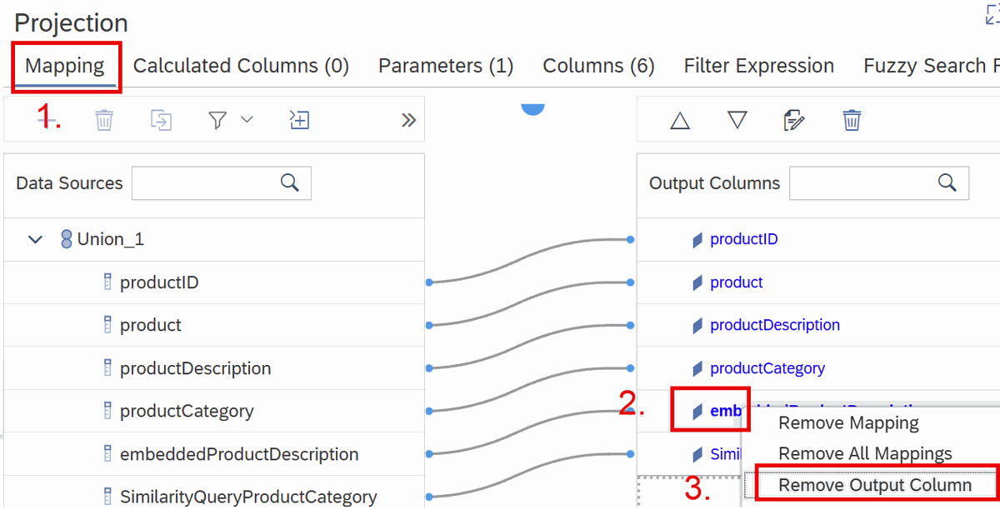

- Check that this solves the issue:
    - Deploy the calculation view using the rocket icon on the top right (or CTRL + d) 
    - Click on (or reopen) the tab with calculation view star join *s_products*
    - If you have not reopened the calculation view: Reload the calculation view using the button *Refresh* so it reads the new definition of the dimension view *I_storeEmbeddingsProductDescription_AllColumns*

    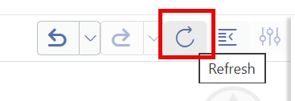

==> The error indicator disappeared

To ensure that the database representation is updated, deploy all calculation views:

- In the SAP HANA PROJECTS explorer on the lower left, press the rocket icon right to the folder *src*. This will deploy all changed files in the project:

todo: there is a bug so the error indicator is not updated. Either fix it, or explain it or move this section before the replacement section.

#### 1.3.3 Map Input Parameters 

*Ensure that all input parameters are available in calculation view s_products*

We had defined input parameter *QueryString* in calculation view *storeEmbeddingsProductDescription*. The input parameter was used for the calculation of the calculated column *SimilarityQueryProductCategory*. Given that we moved the calculated column to calculation view *I_storeEmbeddingsProductDescription_AllColumns* we need to define the input parameter there. In addition, reporting will rely on calculation view *s_products* which therefore requires all relevant underlying input parameters that should be prompted during reporting. 

Let's propagate *QueryString* through all dependent calculation views in one step first:

- Click on (or reopen) the tab with calculation view *storeEmbeddingsProductDescription*
- Double-click on node *Semantics* to see the details
- Click on tab *Parameters* to show the input parameter *QueryString* (1.)
- Use the drop down *Propagate* (2.)
- Choose *Adding* (3.)

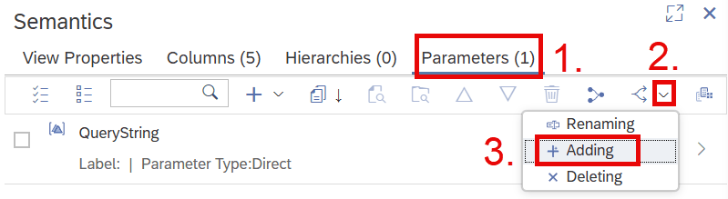

This will propagate the input parameter to all dependent calculation views in the current project

- In the dialog *Propagate Adding Input Parameter*: 
    - Select input parameter *QueryString* by clicking on it (1.)
    - Press *Check Impact* to see the dependent calculation views (2.)

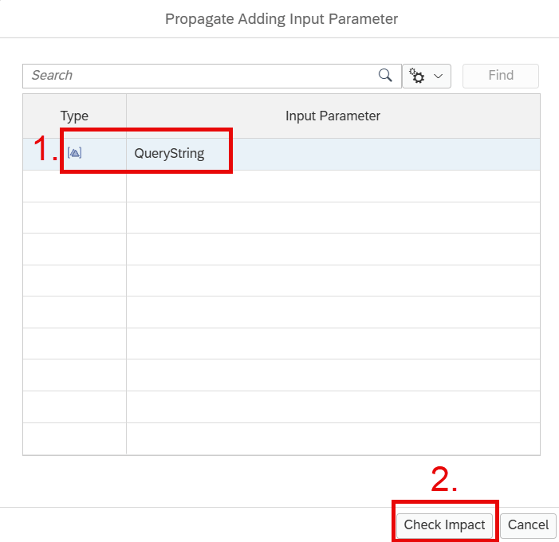

The next dialog lists the impacted calculation views to which the input parameter will be propagated.

- Expand the first dependent calculation view to see the indirect dependent calculation view *s_products* (1.)
- Select both calculation views (either individually, or using the *Select All* check box on top) (2.)
- Validate the choice by pressing *Validate*. This validation will check, for example, whether naming conflicts would arise by propagating the input parameter (3.)

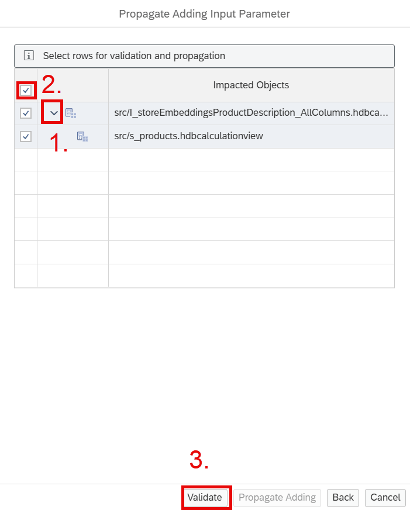

- After the successful validation, click button *Propagate Adding* to propagate the input parameter to all dependent calculation views in the current project
- Press button *Finish* to close the dialog and to build the impacted views
- You can now remove the input parameter from the current view by selecting it (1.) and pressing button *Remove* (2.)

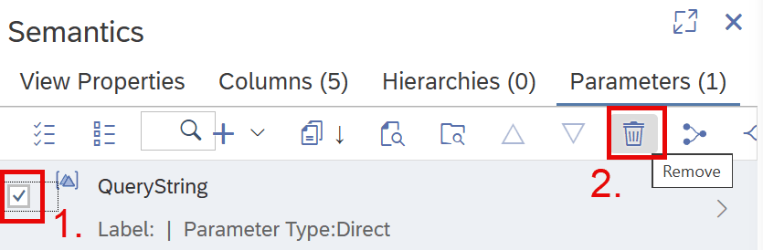

- An information box informs you about the impact of this removal action. Proceed with *Yes*

Let's propagate the parameter *I_SOURCE* from calculation view *I_storeEmbeddingsProductDescription_AllColumns* to *s_products* so we can select between *SNAPSHOT* and *BASE* data when querying *s_products*:

- Click on (or reopen) the tab with the calculation view *s_products*
- Double-click on node *Semantics* to see the details
- Select tab *Parameters* (1.)
- Click *Manage Parameter Mapping* (2.)

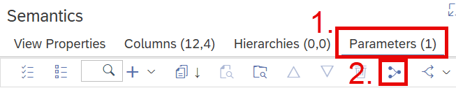

You see the propagated input parameter *QueryString* and its mapping. This has been generated by the input parameter propagation. Input parameter *I_SOURCE* is only missing in view *s_products*, so we can create the mapping directly:

- Click on the left at the line of *I_SOURCE* (1.), keep the mouse button down and move to an empty line on the right (2.) where you release the mouse button

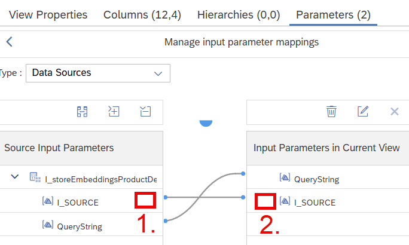

==> In the current view an input parameter with the same name as the selected one of the source has been created and mapped to the source view input parameter. You see 2 Parameters in the tab *Parameters* now.

All input parameters are mapped. Before we start a data preview on *s_products*, let's first define a sorting of the result based on the similarity score in *I_PD_SimilarityQueryProductCategory*:

> Note: the column is now called *I_PD_SimilarityQueryProductCategory* in *s_products* because of the prefix applied during the Replace Data Source step.

- Define a sort order of the results:
    
    - Click on tab *Columns* to see the output columns of the node *Semantics*
    - Press button *Sort Result Set*

    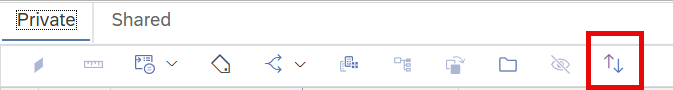

In the dialog:

- Click on the + icon to add a sorting criterion (1.)
- Select column *I_PD_SimilarityQueryProductCategory* on which the sorting should be based on (2.)
- Choose *Descending* to see the best matching records first (3.)
- Close the dialog with *OK* (4.)

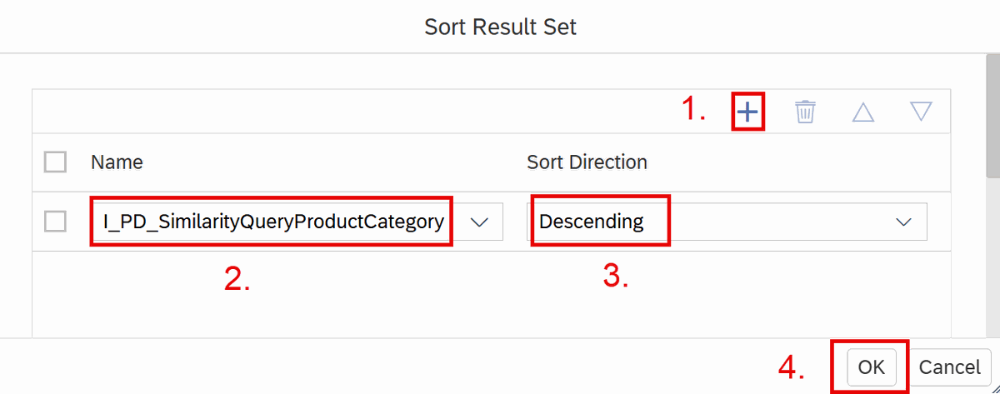

==>  To ensure that the database representation is updated, deploy all calculation views:

- In the SAP HANA PROJECTS explorer on the lower left, press the rocket icon right to the folder *src*. This will deploy all changed files in the project:

*Run a data preview to see your model in action*

- Right-click on node *Star Join* and choose *Graphical SQL Data Preview*

==> You will be prompted for values for your input parameters *QueryString* and *I_SOURCE*

- Either keep the default value for both or change them to your liking

- Press *Open Content* (the "play" icon) to display the values

- Select tab *Raw Data* to see the raw values 

==> The default query has no explicit order specification that would otherwise overwrite your specification in the calculation view and you see the data sorted according to your definintion based on the similarity column in descending order.

- Switch to tab *Analysis* and drag and drop the columns of your interest. Here is an example:

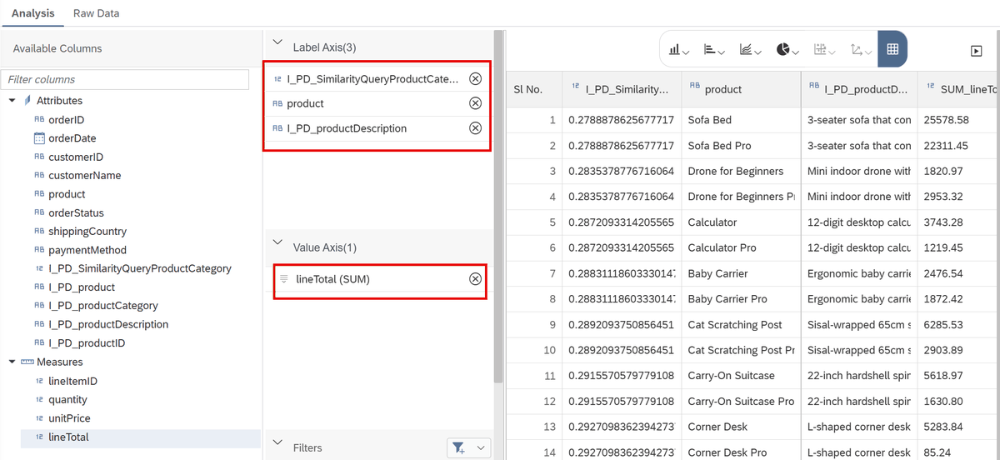

==> The Analysis tab explicitly sorts the results according to the sequence under *Label Axis*. This overwrites the defined sorting order based on *I_PD_SimilarityQueryProductCategory*

[next exercise](./README1.4.md)