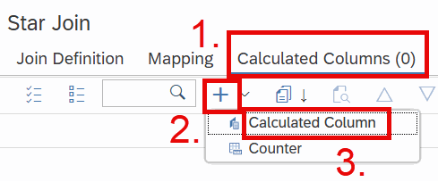
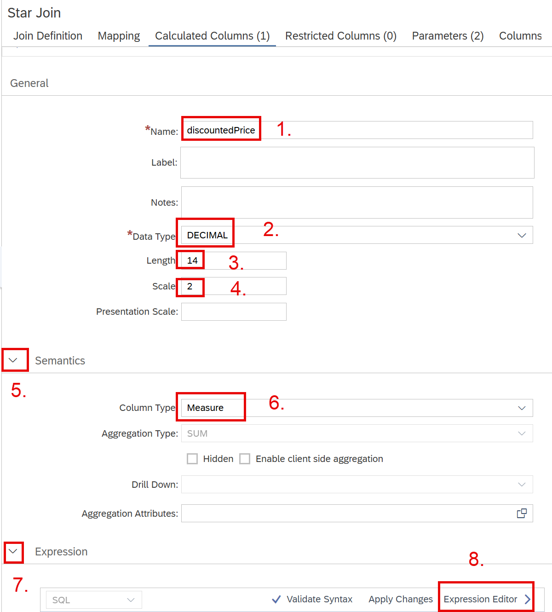
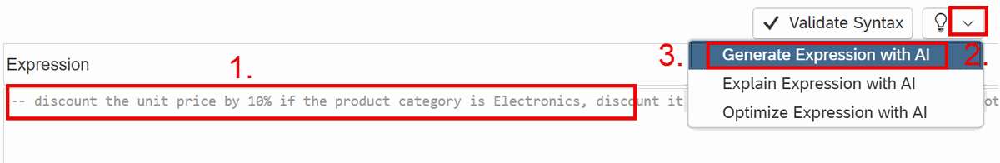
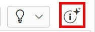
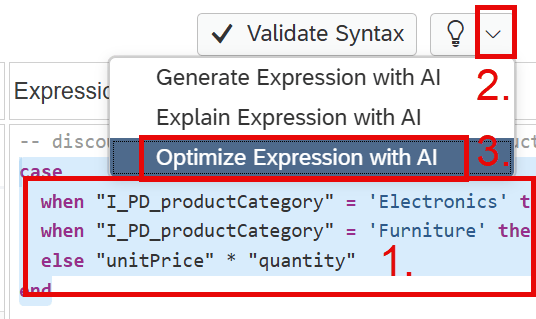
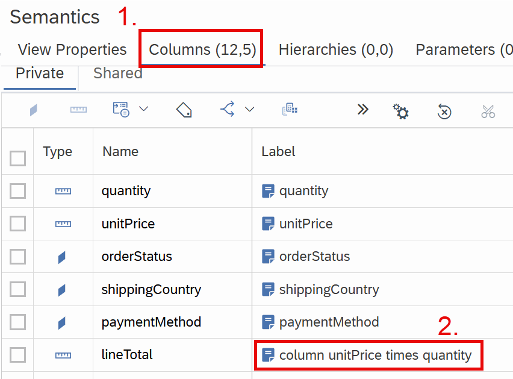
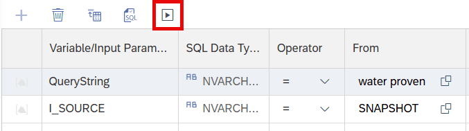

### 1.4 Use AI Support when Working with Expressions

*Add a calculated column that calculates different discounts depending on the product category*

In the previous sections, you could generate the calculated expressions using AI support. Let's dig into this option in more detail by creating a calculated column that calculates different discounts based on product categories.

- Click on (or reopen) the tab with the calculation view *s_products*
- Double-click on node *Star Join* to see the Details
- Click on tab *Calculated Columns* (1.)
- Use the + icon drop-down (2.)
- Select *Calculated Column* (3.)



- Click on the created calculated column to display the details
- Name the calculated column *discountedPrice* (1.)
- Choose *Decimal* as *Data Type* (2.)
- Enter *14* as *Length* (3.)
- Enter *2* as *Scale* (4.)
- Expand section *Semantics* (5.) 
- Choose *Measure* as *Column Type* (6.)
  
    As *discountedPrice* has been automatically added to the output, a dialog informs you that changing it to a measure changes this output column. 
- Continue with *Yes*
- Expand section *Expression* (7.)
- Click on *Expression Editor* to open the editor (8.)



In the expression editor:

- Enter (1.): 
  ```SQL
  -- discount the unit price by 10% if the product category is Electronics, discount it by 20% for Furniture. Calculate the total sum
  ```

- Use the *AI actions* drop down (2.)
- Select *Generate Expression with AI* (3.)



==> A dialog will inform you about the use of AI functionality. Close the dialog. An expression will be generated based on your description.

The generated expression will look similar to:

```SQL
case 
  when "I_PD_productCategory" = 'Electronics' then "unitPrice" * 0.90 * "quantity"
  when "I_PD_productCategory" = 'Furniture' then "unitPrice" * 0.80 * "quantity"
  else "unitPrice" * "quantity"
end
```

If you expand *Calculation Views* and *Columns* on the left side, you see that the correct column names are used in the expression even though the exact names were not used in the prompt. In the prompt, the columns are described as *product category*, *unit price* or *total sum*. This shows the strength of the AI support, which transforms requests like *total sum* into the multiplication of *unitPrice* and *quantity*.

Using the correct column names in the generated expression is achieved by also adding information about the available column names and descriptions to the background prompt. You can read what information is sent to the large language model when clicking on the info button:



Let's check whether the generated statement can be further optimized using AI support:

- Select the generated expression (1.)
- Use the *AI actions* drop-down (2.) 
- Choose *Optimize Expression with AI* (3.)



You will probably see an expression similar to:

```SQL
("unitPrice" * "quantity") *
  case 
    when "I_PD_productCategory" = 'Electronics' then 0.90
    when "I_PD_productCategory" = 'Furniture'    then 0.80
    else 1
  end
```

In this generated expression the multiplication is moved outside of the *CASE* statement. Repeat the optimization process:

- Select the newly generated expression and choose *Optimize Expression with AI* again 

This will probably lead to:

```SQL
"lineTotal" *
  CASE
    WHEN "I_PD_productCategory" = 'Electronics' THEN 0.90
    WHEN "I_PD_productCategory" = 'Furniture' THEN 0.80
    ELSE 1
  END
```

This time the multiplication of *unitPrice* with *quantity* is replaced by the column *lineTotal*. By applying optimizations multiple times eventually better solutions can be achieved in an iterative process.

If you are curious about how it was possible to know that the multiplication can be replaced by column *lineTotal*:

   - Double-click on node *Semantics* to see the details
   - Click on tab *Columns* to show all columns (1.)
   - Look at the Label of column *lineTotal* (2.)

   

  The *Label* of column *lineTotal* was automatically read from the comment to the column in the source table and propagated to the *Semantics* node. Based on this description, the AI support could decide to replace the multiplication by the column.

- Go back to the expression:
    - Double-click on the node *Star Join* 
    - Select tab *Calculated Columns*
    - Click on the calculated column to open the details
    - Click *Expression Editor* to open the editor

In this case you have designed the expression recently but imagine you encounter an expression that you have created a long time ago and forgotten about it, or it was created by someone else. In this situation you can ask for AI support to understand the existing expression. Let's do that for illustrative reasons next:

- Select the expression and choose *Explain Expression with AI*

- Check whether the explanation matches to the expression and is useful

- Finally, let's see the calculated column in action:

    - Deploy the model by clicking on the rocket on the top-right, or using *CTRL* and *d*

    - Right-click on node *Star Join* and choose *Graphical SQL Data Preview*

    You will be prompted for values for your input parameters *QueryString* and *I_SOURCE*

    - Either keep the default values for both or change them to your liking

    - Press *Open Content* ("play" button) to display the values

    

    - Select tab *Raw Data* to see the raw values 

==>	You see the *lineTotal* discounted depending on the product category in column *discountedPrice*.

[next exercise](./README1.5.md)