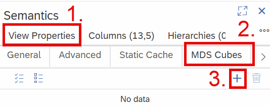
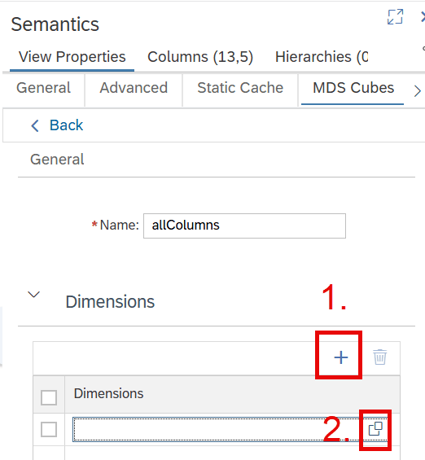
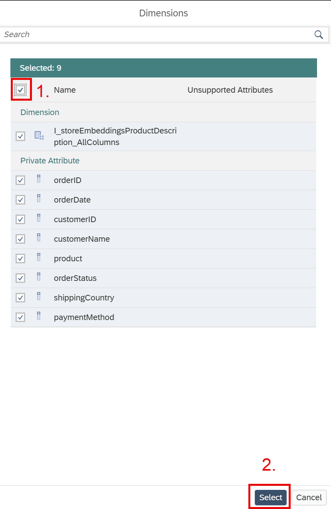

### 1.5 Define an MDS Cube

We have used the snapshot technology above as one materialization option. MDS Cubes are another way of materializing data. MDS Cubes materialize data in a format that is highly optimized for analytic queries in SAP Analytics Cloud. You can use this as a complementary optimization option in combination with snapshots or as an alternative if you only use SAP Analytics Cloud for reporting. MDS Cubes need to be defined in the calculation view that is directly used by SAC.

*Create an MDS Cube "AllColumns" and add all available dimensions and measures to it*

- Open (or click on the tab of) calculation view *s_products*
- Create an MDS Cube:
    - Double-click on node *Semantics*
    - Click on tab *View Properties* (1.)
    - Click on tab *MDS Cubes* (2.)
    - Use the + icon to add an MDS Cube (3.)

- Click on the created MDS Cube to open its details

- Add Dimensions:
    - Under section *Dimensions* click on the + icon to create an entry (1.)
    - Click on the value help icon to select the dimensions that should be added (2.)

In the dialog 
- Check the select-all box to select the dimension view as well as all dimensions (private attributes) (1.)
- Press *Select* to add all to the MDS Cube (2.)

- Repeat the steps under section *Measures* to add *quantity*, *unitPrice* and *lineTotal* as measures

- Deploy the model by clicking on the rocket on the top-right, or using *CTRL* and *d*

==> Your MDS Cube is now defined and can be selected in SAP Analytics Cloud for reporting

[next exercise](../ex2/README2.0.md)