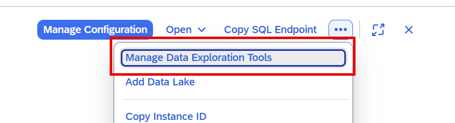
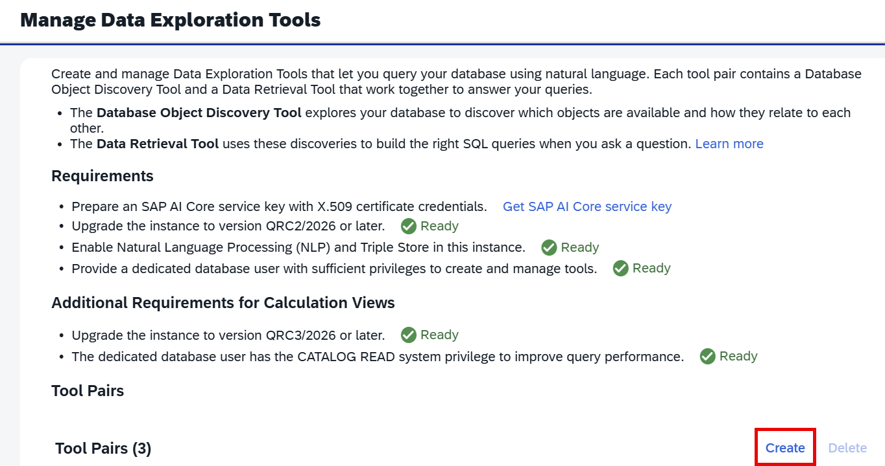
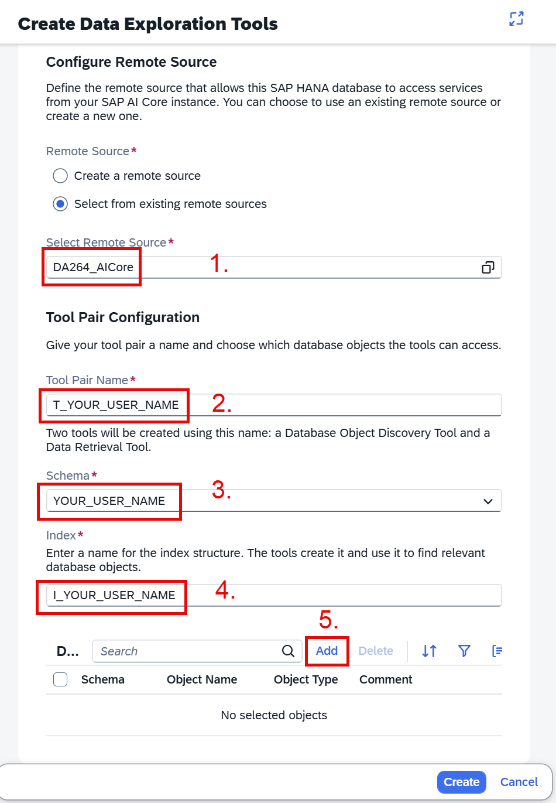
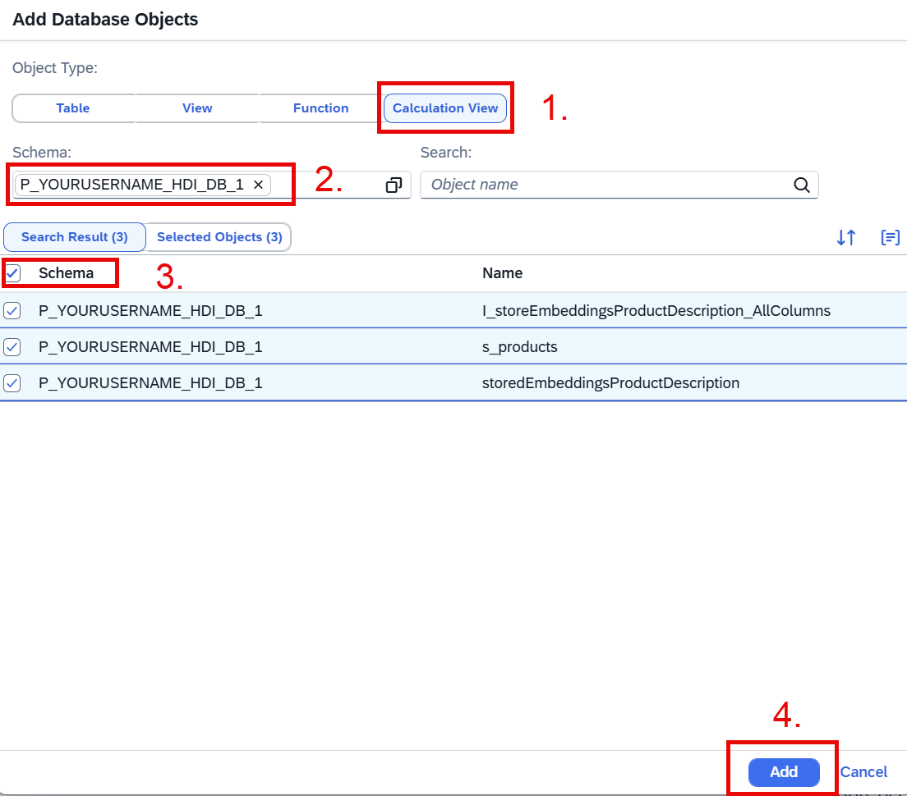
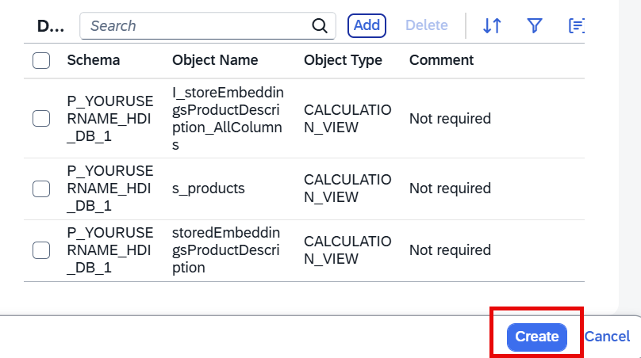
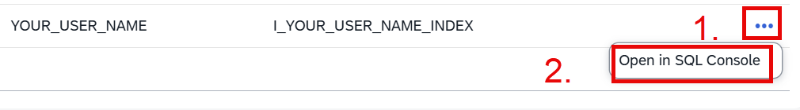
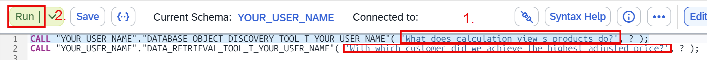

## 2.1 Load Calculation View metadata into a knowledge graph and create Data Exploration Tools

*Create Data Exploration Tools that are based on all your calculation views*
- On the top right, under the 3 dots, choose *Manage Data Exploration Tools*:

    

==> The next screen informs you that all pre-requisites are met and you can proceed to create the Data Exploration Tools

*Create the Data Exploration Tools*
- On the right side, click on *Create*:

- Fill in the details:

    > **Note:** Make sure to replace the string *<YOUR\_USER\_NAME>* with your actual user name below.

    - Choose radio button *Select from existing remote sources* and select *DA264_AICore* (1.). The Remote Source connects to the SAP AI Core service that processes the natural language queries.
    - For *Tool Pair Name* enter T\_<YOUR\_USER\_NAME> (2.)
    - As *Schema* choose the schema with <YOUR\_USER\_NAME> (3.)
    - Name *Index* with *I\_<YOUR\_USER\_NAME>* (4.)
    - Press *Add* to select the objects that should be integrated into the knowledge graph (5.)

    

*Add all calculation views to the knowledge graph*

- Select *Calculation View* as *Object Type* (1.)
- Select the schema with *<YOUR\_USER\_NAME>* (2.)
- Check the *Schema* box to select all calculation views in your schema (3.)
- Click on button *Add* to load the information about these objects into the knowledge graph (4.)

- Click *Create* to start loading the knowledge graph and to create the tools

==> You will see a status message that creation is in progress:

Wait till the creation is finished and refresh the display from time to time by pressing the refresh button on the top right. This can take 2-3 minutes.

## 2.2 Use Data Exploration Tools

When creation is finished:

*Ask natural language questions about your calculation views and data using the two Data Exploration procedures*

- Click on the three dots next to your tool pair with your user name (1.)
- Choose *Open in SQL Console* (2.)

In the SQL Console two call statements to the two created procedures are already prepared. The first procedure starting with *DATABASE_OBJECT_DISCOVERY_TOOL* is for asking questions about the objects in your knowledge graph and the answers are mainly based on metadata. The second procedure starting with *DATA_RETRIEVAL_TOOL* can be used for questions about data that are retrieved by the objects and can be used for analytic questions. Try some questions yourself! 

*Enter some questions as first parameter to the two procedures*

- Replace the placeholder text between the single quotes in the first parameter of the CALL statement with your question (1.). For example ask with the first procedure *What does calculation view s_products do?* and *With which customer did we achieve the highest discounted price?* with the second.
- Highlight one entire CALL statement
- Press *Run* (2.)

==> The procedure returns a natural language answer based on your calculation view definitions and data.

You have now successfully created tools and exposed them via database procedures. These procedures can be used to answer natural language questions about your objects and data returned by these objects.

In the next section we will explore how these same calculation views can be integrated into SAP Business Data Cloud.

[next exercise](../ex3/README3.0.md)