## 3.1 Semantic Onboarding 

In this exercise, we show how calculation views created in SAP HANA Cloud can be reused in SAP Datasphere. The data stays in SAP HANA Cloud but we will create a proxy object in SAP Datasphere to offer an easy way to integrate calculation views into SAP Datasphere modeling. This process of making proxy objects of calculation views available in SAP Datasphere is called Semantic Onboarding.

### 3.1.1 Prepare the calculation view for semantic onboarding

The semantic onboarding process starts in SAP Business Application Studio by marking calculation views as available for semantic onboarding. This way the developer of the calculation view controls whether or not a calculation view can be semantically onboarded.

*Make calculation view "s_products" available for semantic onboarding*

- in SAP Business Application Studio double click on calculation view file *s_products* in the left *EXPLORER* window to open *s_products* in the editor.

*Choose "Construction Kit" as SAP Business Data Cloud Integration Mode*
- Click on node "Semantics" to open the Semantics details (1.)
- Navigate under *View Properties* and *General* to the field *SAP Business Data Cloud Integration Mode*
- Select *Construction Kit* from the drop-down (2.)

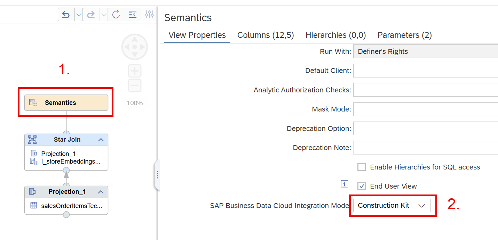

Mode *Construction Kit* exposes only the Private columns of a star-join. Choose this mode if the model in SAP Datasphere should be flexibly changed or enhanced. *Construction Kit* exposes the transactional data separately from the dimension views. We will later also expose the dimension view *I_storeEmbeddingsProductDescription_AllColumns* and see that it will be automatically associated to the transactional data in SAP Datasphere. 

The alternative mode *Flat View* exposes all columns of the current star-join view as a flat structure. This is a quick way to expose all columns, also of the dimension views, but at the same time this reduces the flexibility to choose which dimensions to reuse in SAP Datasphere and also leads to loss of structural information such as hierarchy information.

- Deploy the model by clicking on the rocket on the top-right, or using *CTRL* and *d*

==> The model will now be available for Semantic Onboarding

### 3.1.2 Semantic Onboard the calculation views into SAP Datasphere

*Start SAP Datasphere*

- Open a new browser tab and navigate to: https://trial-bdc-datasphere-3.eu10.hcs.cloud.sap/dwaas-core/index.html#/home

*Start the semantic onboarding process for calculation view "s_products"*

- Click on icon *Semantic Onboarding*

    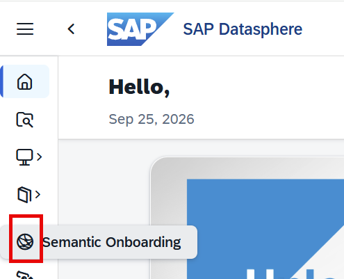

- Choose the *SAP HANA* connection by clicking on it

    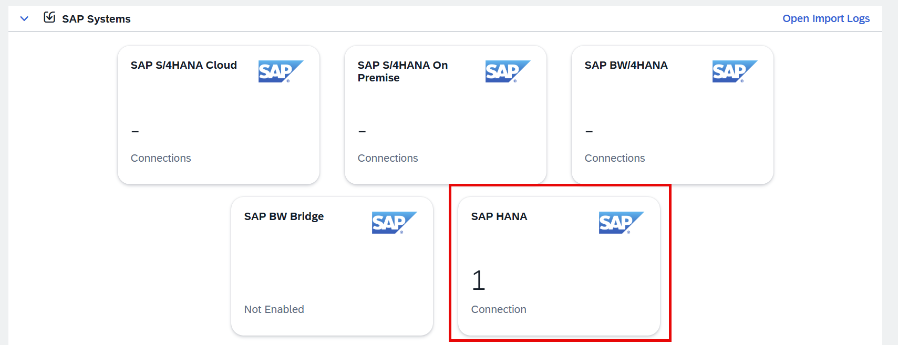

- Choose space *TECHED2026_DA264* by clicking on it (1.)
- Click on *Next Step* (2.)

    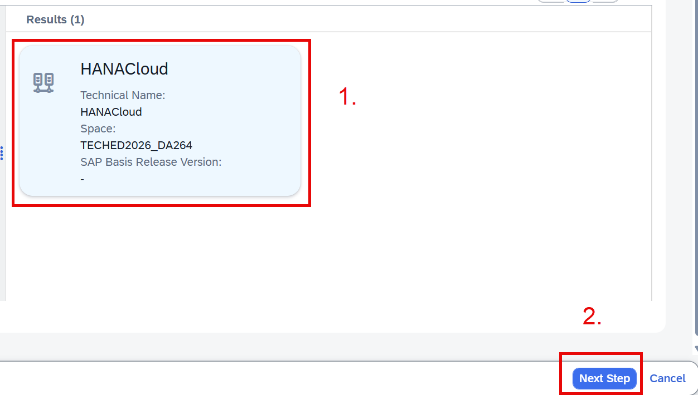

*Choose calculation view "s_products" that is in the schema with your user name for import*
- Make sure that you filter on the schema with your user name (1.)
- Select calculation view *s_products* in your schema (2.)
- Click on *Next Step* (3.)

    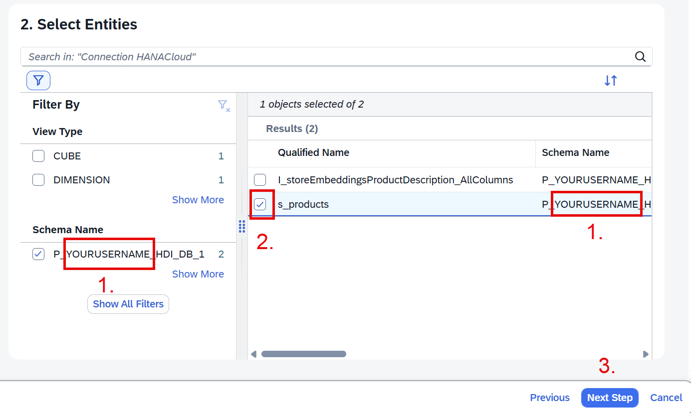

- In the next screen choose *Start Import and Deploy*

    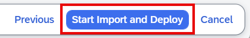

==> The import and deployment starts. You will see a notification when deployment has finished.

*Open the deployed model*
- Click on the notification icon to see the details (1.)
- Click on the topmost import statement to open your model (2.)

    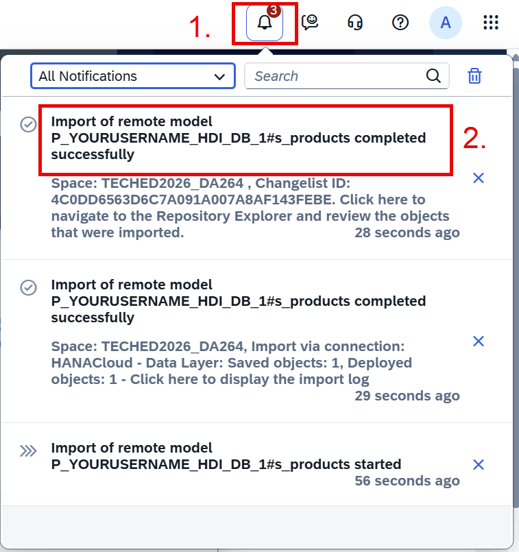

- Click on your Remote Table *s_products* to open it
    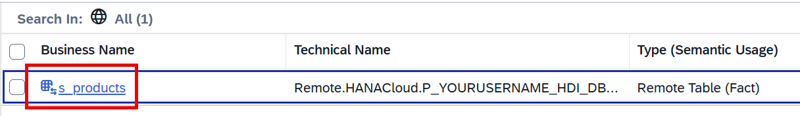

==> The model has taken over information about the input parameters (1.). However, no associations are defined (2.) because we did not import the dimension view yet. Let's do this next.
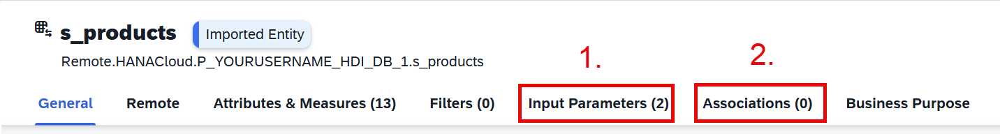

*Semantic Onboard the dimension view "I_storeEmbeddingsProductDescription_AllColumns"*
- In SAP Business Application Studio:
    - Double click on calculation view *I_storeEmbeddingsProductDescription_AllColumns* in the EXPLORER window on the left side to open it
    - Click on node "Semantics" to open the Semantics details
    - Navigate under *View Properties* and *General* to the field *SAP Business Data Cloud Integration Mode*
    - Select *Construction Kit* from the drop-down 
    - Deploy the model by clicking on the rocket on the top-right, or using *CTRL* and *d*

==> The dimension view *I_storeEmbeddingsProductDescription_AllColumns* is now prepared for semantic onboarding. Dimension views offer only the integration mode *Construction Kit* to keep the structural details such as hierarchies.

- In SAP Datasphere:
    - Follow the steps from above for dimension view *I_storeEmbeddingsProductDescription_AllColumns*:

        - Click on icon *Semantic Onboarding*
    
            

        - Choose the *SAP HANA* connection by clicking on it
    
            

        - Choose space *TECHED2026_DA264* by clicking on it (1.)
        - Click on *Next Step* (2.)
    
            

        *Choose calculation view "I_storeEmbeddingsProductDescription_AllColumns" in the schema with your user name for import*
        - Make sure that you filter on the schema with your user name
        - Select calculation view *I_storeEmbeddingsProductDescription_AllColumns* in your schema (1.)
        - Click on *Next Step* (2.)
    
            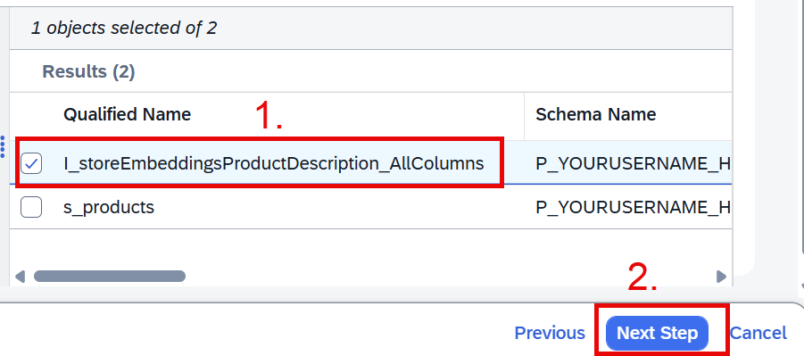 --> todo

        - In the next screen choose *Start Import and Deploy*
    
            

        ==> The import and deployment starts. You will see a notification when deployment has finished.

        *Open the deployed model*
        - Click on the notification icon to see the details (1.)
        - Click at the topmost import statement to open your model (2.)

        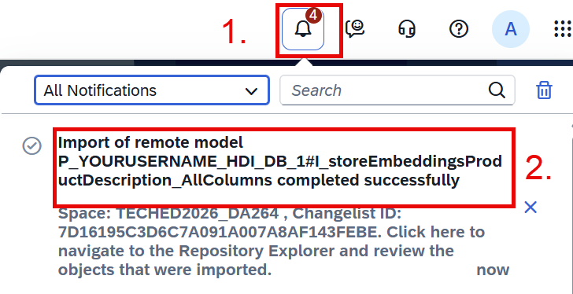 --> todo

        - Click on your Remote Table *I_storeEmbeddingsProductDescription_AllColumns* to open it

        ==> The model has taken over information about the input parameters. 
        
    *Check how the Remote Table of the star-join view "s_products" has changed by the import of the dimension view.*

    - Click on icon *Repository Explorer* on the left (1.)
    - Choose *My Objects* (2.)
    - Click on *s_products* (3.) to open the Remote Table

        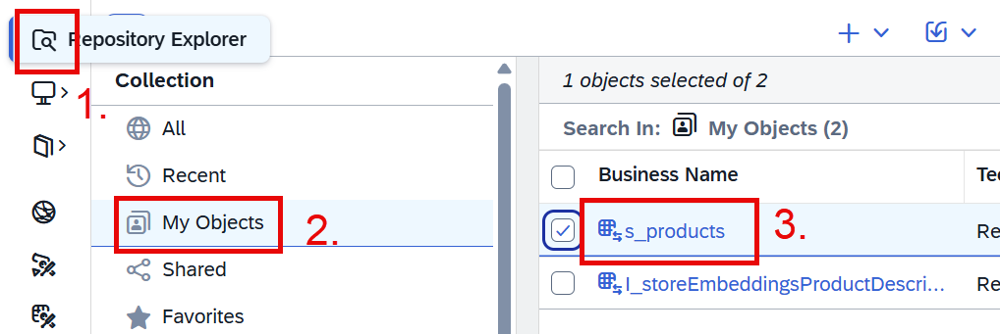

    - Click on *Associations* to see that the dimension view *I_storeEmbeddingsProductDescription_AllColumns* has been associated
        
        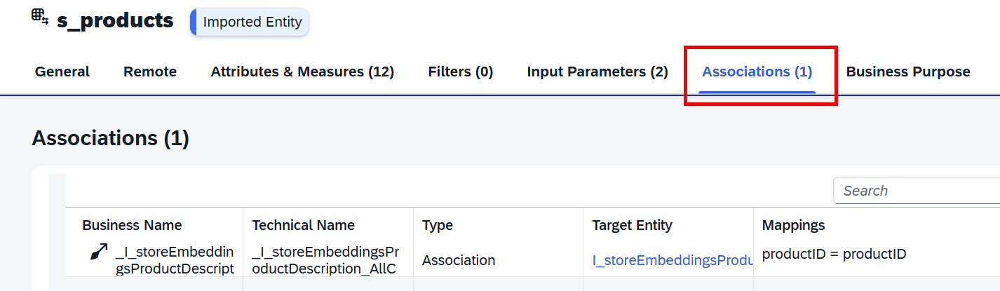

    ==> *I_storeEmbeddingsProductDescription_AllColumns* was used as a dimension view of *s_products* in the calculation view. When both views are deployed into SAP Datasphere, this association is automatically recreated.

### 3.1.3 Create an Analytic Model

Let's create an analytic model next so you can continue modeling in SAP Datasphere based on the calculation view model in SAP HANA Cloud.

*Create an Analytic Model*
- Click on tab *General* to navigate back to the top (1.)
- Use button *Create Analytic Model* (2.) to create an Analytic Model

    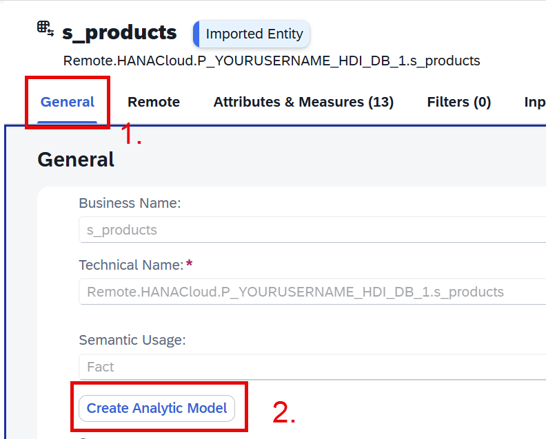

==> An Analytic Model is created and opened

*Run a data preview as a quick validation check*
- Click on the disk-icon to save the Analytic Model

    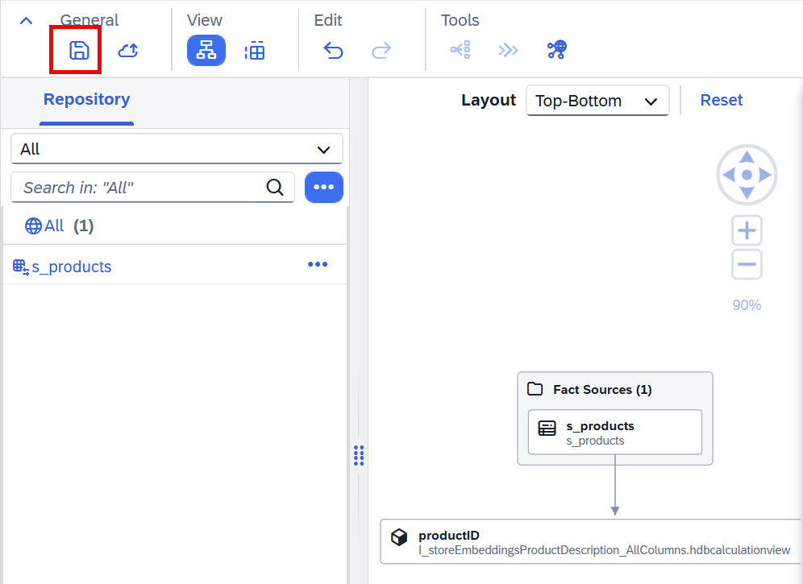

==> A warning box informs you that you have not specified a key column in dimension view *I_storeEmbeddingsProductDescription_AllColumns*

- Click on *Save Anyway* to continue saving

    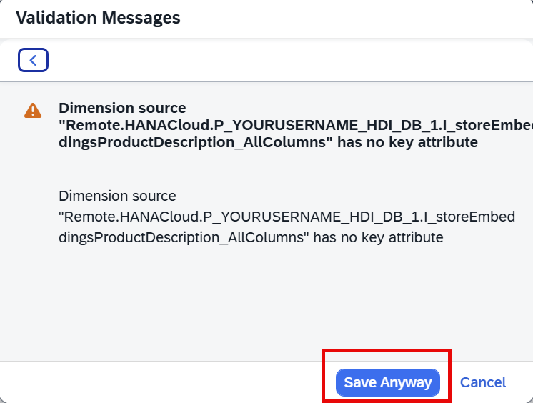

- Name the Analytic Model *AM_\<YourUserName\>* (1.) 
- Press button *Save* (2.)

    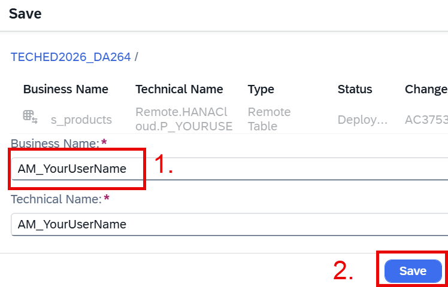

### 3.1.4 Run a Data Preview on the data from SAP HANA Cloud

- Start a data preview by clicking on *Preview*

    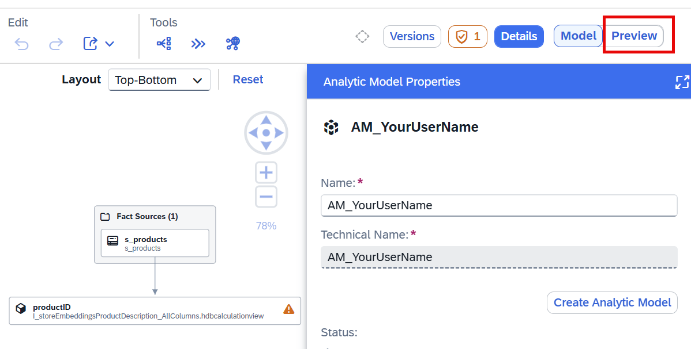

- Enter a value for the empty input parameter, e.g., *display screens* (1.)
- Press *Set* to use the input parameters during data preview (2.)

    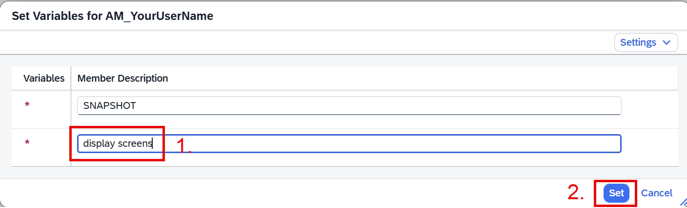

==> The data are fetched from HANA Cloud and displayed. You can now add or remove columns from the preview screen

*Add columns "productDescription" and "similarityToQuery" to the Rows*
- Expand the dimension *productID* (1.)
- Click on the Row icons to add columns *productDescription* and *similarityToQuery* to the *Rows*

==> The data display is refreshed and you can now see both columns 

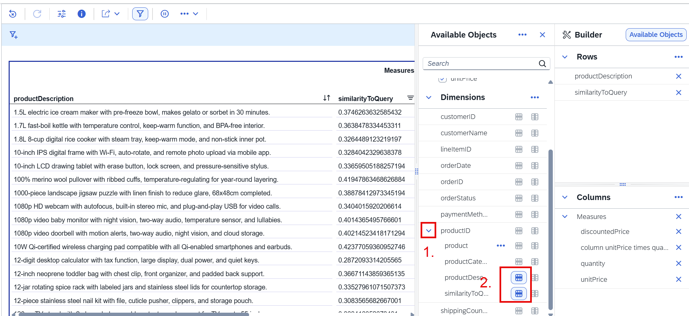

todo:
roles have to be granted to DBADMIN (connection user):
grant "TEST_HDI_DB_1::access_role" to DBADMIN